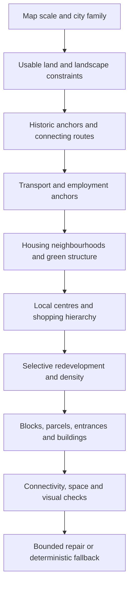

# Dutch city structure: research and generation rules for RIM

Prepared 4 October 2026. Read this alongside [CLAUDE_CITY.md](CLAUDE_CITY.md), the [current generator audit and 20 improvements](review/city_gaps_2026-10-04/REVIEW.md), and the [32 municipality profiles](review/dutch_city_research_2026-10-04/CITY_PROFILES.md).

The subsequent France and UK comparison is integrated in [EUROPEAN_CITY_GENERATION.md](EUROPEAN_CITY_GENERATION.md), with country evidence in [FRANCE_CITY_ANALYSIS.md](FRANCE_CITY_ANALYSIS.md) and [UK_CITY_ANALYSIS.md](UK_CITY_ANALYSIS.md). Use the combined synthesis for the expanded set of block, frontage, housing, and shopping patterns.

## Purpose and scope

The goal is a generated city with convincing residential neighbourhoods, shopping destinations, employment areas, suburbs, parks, and connected streets. Dutch cities provide useful relationships between those places. RIM should compress those relationships into a readable game map while retaining its cyberpunk architecture and lighting.

This is a **qualitative, source-based comparison of 32 municipalities**, with deeper analysis of Amsterdam, Rotterdam, and The Hague. The working definition of “big” is more than 100,000 municipal residents in the CBS 2026 dataset. The [population roster](review/dutch_city_research_2026-10-04/municipalities_over_100k_2026.json) records that selection. Municipalities can contain several towns, villages, countryside, airports, and ports; population does not define the continuous urban footprint. [CBS: regional figures 2026](https://www.cbs.nl/nl-nl/cijfers/detail/86247NED).

The research identifies documented patterns and possible generating rules. It does **not** yet include measured zoning polygons, land-use percentages, street-network statistics, or a complete inventory of every neighbourhood. Planned development is distinguished from existing development throughout the profiles. Do not turn a city's 2040 vision into a claim about its present layout.

Real cities have no single creation algorithm. Geography, trade, institutions, land ownership, transport, housing demand, public plans, destruction, and redevelopment interact over time. The algorithm below is our proposed game abstraction, not an algorithm used by Dutch municipalities or a proven reconstruction of their history.

## The main finding

Generate **a history of connected places**. Establish several purposeful anchors, connect them, grow coherent neighbourhoods around them, and selectively replace older sites. A district should describe an area's character; it should not require every building inside it to have the same use.

| Question | Research-led answer for the generator |
|---|---|
| Where is the business district? | Often near stations, regional routes, universities, institutions, or freight infrastructure. It can be separate from the historic centre and can have several nodes. |
| Where do people live? | In the centre as well as surrounding neighbourhoods. Housing form changes with development era, accessibility, and available land. |
| Where are the shops? | In a hierarchy: central shopping streets, district centres, neighbourhood shops, and specialised peripheral destinations. Homes may sit above shops. |
| What makes suburbs believable? | Repeated groups of houses, coherent street access, gardens, local amenities, and green space. Include terraced housing; detached houses are one option. |
| What makes streets believable? | Routes follow destinations and inherited boundaries. Different neighbourhoods use different block patterns. Straight streets can be entirely appropriate. |
| What is water for? | A river, drainage structure, harbour, canal, or coastal boundary with a specific spatial role. It is optional in the compressed RIM map. |

These are inferences from the cases below and the linked profiles, not measured rules that apply identically to all Dutch cities.

## Three cities in depth

### Amsterdam: successive expansions and several economic centres

**Historical structure.** The canal expansion organised new streets, plots, residences, trade, and work around an existing city. Different streets accommodated different activities: prestigious canal frontage and smaller cross streets did not perform identical roles. Later housing developments introduced enclosed blocks, garden villages, and larger planned residential areas. These are distinct layers, not one repeating canal template. [Amsterdam City Archives: canal expansion](https://www.amsterdam.nl/stadsarchief/canon/venster/12/), [Amsterdam audit office: urban green-space history](https://publicaties.rekenkamer.amsterdam.nl/groen-in-de-stad/).

**Employment and retail.** Zuidas is a business concentration associated with major transport connections, separate from the old shopping centre. Its development towards a fuller mixture of housing and amenities is ongoing. Amsterdam's retail dashboard distinguishes central shopping areas such as Kalverstraat, neighbourhood centres such as Lambertus Zijlplein, and peripheral shopping clusters. A retail street and a tower district should therefore be separate generator concepts. [Zuidas history](https://zuidas.nl/en/the-history-of-zuidas/), [municipal shopping-area dashboard](https://onderzoek.amsterdam.nl/static/dashboard-winkelgebieden/).

**Growth policy.** The municipal vision promotes multiple centres and transformation of existing urban areas. This is a direction for future development, not evidence that every planned centre or mixed district is complete. [Amsterdam 2050 vision](https://www.amsterdam.nl/bestuur-organisatie/beleid/omgevingsvisie-amsterdam-2050/).

**RIM translation.** Start with a compact mixed centre and connected frontage. Add residential expansions with different block and garden arrangements. Put a later office cluster near a transport anchor. Use one restrained canal or waterfront only if complete neighbourhoods still fit. Do not reproduce Amsterdam by surrounding isolated towers with blue tiles.

### Rotterdam: reconstruction, port corridors, and district centres

**Centre and shopping.** Rotterdam's reconstructed centre combines a different street and building structure from its older neighbourhoods. Lijnbaan and Schouwburgplein have different commercial and public-space roles. Zuidplein and Alexander provide other centres associated with transport and services. This supports several destinations with distinct roles instead of one central commercial blob. [Rotterdam: city centre and other centres](https://welstandsnota.rotterdam.nl/verdieping/reguliere-criteria-gebieden/stadscentrum-en-centrumgebieden).

**Residential structure.** The city's description of nineteenth-century expansions explains how inherited polder divisions shaped streets: straight layouts north of the river and different alignments in southern areas. Later housing ensembles introduced repeated slabs or groups with shared green space. “Organic” growth can preserve straight boundaries; random bending is not an adequate historical model. [Older expansions](https://welstandsnota.rotterdam.nl/verdieping/reguliere-criteria-gebieden/organisch-ontwikkelde-uitbreidingen), [postwar housing ensembles](https://welstandsnota.rotterdam.nl/verdieping/reguliere-criteria-gebieden/stempel-en-strokenbouw).

**Port and redevelopment.** Port facilities extend along a directional corridor towards the sea. The port map is useful for this spatial relationship, without importing its entire area into a small city scene. Kop van Zuid illustrates conversion of former port land into a mixed urban district supported by new connections. [Port of Rotterdam: 2022 map, page 2](https://www.portofrotterdam.com/sites/default/files/2022-06/facts-and-figures-port-of-rotterdam.pdf), [Rotterdam City Archives: Kop van Zuid](https://stadsarchief.rotterdam.nl/herontwikkeling-kop-van-zuid).

**RIM translation.** Use a compact modern centre, one secondary shopping/transport destination, coherent residential ensembles, and an optional industrial edge connected to an off-map freight route. Reserve bridges and their approaches before placing a waterfront skyline. Represent most of a large port outside the playable scene.

### The Hague: institutions, station districts, and a coastal centre

**Origin.** The court around the Binnenhof attracted settlement, suppliers, and services near an existing landscape boundary. An institution can therefore be an initial urban anchor independently of a port or factory. [The Hague Municipal Archives: court and settlement](https://haagsgemeentearchief.nl/ontdek-de-stad/verhalen-van-de-stad/vroege-bewoning-hof-en-dorp-1230-1568).

**Employment and housing.** The Central Innovation District connects areas around Centraal, Hollands Spoor, and Laan van NOI with government, businesses, education, and residents. Its further growth is a project, not a finished condition. Scheveningen contains contrasting neighbourhood forms: village streets, a harbour area, broad residential avenues, and greener villa districts. Binckhorst adds a former industrial area undergoing mixed redevelopment. [CID](https://www.denhaag.nl/nl/projecten-in-den-haag/central-innovation-district/), [Scheveningen neighbourhoods](https://www.denhaag.nl/nl/stadsdelen/scheveningen/wijken/), [Binckhorst](https://www.denhaag.nl/nl/projecten-in-den-haag/ontwikkelingen-binckhorst/).

**Shopping.** The city's 2017 retail framework describes a hierarchy including central, district, neighbourhood, and specialist shopping environments. Use this as documented planning logic, not a claim that all targets are currently achieved. [Retail framework, especially pages 4–6](https://denhaag.raadsinformatie.nl/document/7054713/1/RIS300626_Bijlage_1_Kadernota_detailhandel_De_Haagse_hoofdwinkelstructuur_centraal).

**RIM translation.** Seed a civic landmark and square, add a station-linked employment cluster, then distinct housing neighbourhoods with local shops. A coastal or leisure destination may form a secondary centre. Coastal influence can be represented at the map boundary; a central river is unnecessary.

## City families to generate

Use these as configurable design families. They overlap and are not official classifications.

| Family | Examples in this study | Distinctive generation choices |
|---|---|---|
| Historic mixed centre with later expansions | Amsterdam, Haarlem, Deventer | Fine frontage in the core; later blocks with larger courtyards; secondary shopping streets. |
| Port and reconstructed centre | Rotterdam | Modern centre; freight corridor; distinct housing eras; selective waterfront conversion. |
| Institutional and coastal city | The Hague | Civic anchor; employment near stations; residential avenues; optional coastal destination. |
| Station and knowledge centres | Utrecht, Leiden, Delft | Historic centre and station/campus as linked but distinct nodes; mixed corridors between them. |
| Industrial and innovation city | Eindhoven, Tilburg, Enschede | Employment anchors, housing expansions, inherited routes, selected industrial reuse. |
| Planned town with several centres | Almere, Zoetermeer | Neighbourhoods and their services planned together; strong green structure; differentiated centres. |
| Green regional centre | Emmen, Apeldoorn | Housing ensembles around green areas; fewer urban landmarks; complete local destinations. |
| Network of settlements and production areas | Westland, Haarlemmermeer, Zaanstad | Multiple inherited centres; substantial non-residential territory; avoid one circular city mask. |

Start implementation with a general mixed city, then a planned green town and a station/business variant. Thirty-two separate generator implementations would add complexity without improving the first result.

## Proposed generation algorithm

The sequence expresses causal dependencies. Implement a small number of deterministic passes; a simulation of centuries is unnecessary.

1. **Set scale and required places.** Decide which destinations fit before drawing terrain. RIM's 18×15 to 38×30 grids are compressed scenes, not whole municipalities at cadastral scale. Select a modest number of neighbourhoods and allocate room for the complete retail and park sites already required by `CLAUDE_CITY.md`.
2. **Reserve usable land and landscape.** Create a broad continuous development area and green structure. Fit optional water to the remaining spatial budget. Check both total water and water inside the intended settlement. Keep a dry-map preset. If sites no longer fit, reduce optional terrain features rather than silently losing neighbourhoods.
3. **Place historical anchors.** Choose a market square, civic institution, crossing, or several old village centres according to the family. Connect these using purposeful main routes. Preserve those routes during later growth.
4. **Add transport and work anchors.** Represent stations, major-road gateways, a campus, or a freight edge as appropriate. A station can initially be a reserved destination and access node; a working railway simulation is not required. Reserve suitable work sites beside the relevant access.
5. **Grow housing in coherent episodes.** Add adjacent groups of perimeter blocks, terraced streets, garden neighbourhoods, or apartment ensembles. Each episode shares an era, building-line rule, street pattern, and green-space pattern. Fit different areas together through transition streets and connecting paths.
6. **Build a road graph, then rasterise it.** Nodes represent meaningful destinations and junctions; edges represent routes. Attach local streets to the main network. Keep local rectangular blocks where useful, vary their proportions, and use bends only for a route, boundary, or terrain reason. Join stair-stepped tile routes continuously. Revalidate connectivity after clipping or rerouting.
7. **Allocate retail through a hierarchy.** Score demand using homes reachable along paths, nearby destinations, and competing centres. Reserve a central shopping frontage, a complete district retail destination on suitable maps, and smaller local shops where supported. Do not assign a mall to every district. The player's map may represent a wider off-map catchment.
8. **Set density from several influences.** Combine neighbourhood era, centre role, transport access, parcel capacity, and intended skyline. Do not make density depend only on distance from the geometric centre. Preserve the existing residential transition rule while allowing separate office landmarks.
9. **Apply limited redevelopment.** Upgrade selected well-connected older work sites into mixed blocks while retaining an old route, warehouse, courtyard, or landmark. Preserve other productive areas and their access. This is a design option, not a requirement that every industrial area disappear.
10. **Create complete sites.** Derive blocks and parcels, then reserve entrances, access paths, courtyards, gardens, service areas, and public space before fitting buildings. A shop can occupy the ground floor below apartments. Park identity comes from usable ground and paths, not a label or scattered tree count.
11. **Validate and repair.** Connect every retained road to the intended main network; give every occupied site an explicit traversable route. Repair or remove useless road fragments before final parcel allocation. After repairs, repeat affected occupancy and site checks. Use a bounded deterministic fallback when the map cannot satisfy its required places.
12. **Render the city as a place.** Draw readable ground, façades facing streets, entrances, restrained water, and coordinated neighbourhood architecture. Apply cyberpunk colour and lighting after the spatial structure is legible. Review at normal zoom with labels hidden.

Use separate deterministic random streams for layout, site assignment, and decoration so a new tree variation does not rearrange the entire street network. Store a generator version with diagnostic output; reproducibility means the same version, seed, and configuration.

### Suitability and state

Use rankings first, then tune from evidence. No coefficients have been calibrated from Dutch GIS data in this study.

| Use | Favour | Penalise or exclude |
|---|---|---|
| Housing | Reachable amenities, quieter local access, parks, coherent neighbouring housing | Inaccessible parcels, incompatible freight activity, insufficient domestic grounds |
| Offices | Station/main-route access, an existing work cluster, useful nearby services | Isolated leftover sites, inadequate access, clashes with required residential sites |
| Local shops | Reachable household demand, pedestrian frontage, route intersections near destinations | Excess competition, back-of-block locations, missing entrance space |
| District shopping | Several neighbourhood catchments, a connected destination site, public space and service access | A building footprint that leaves no complete grounds |
| Industry/logistics | Freight gateway, larger sites, compatible neighbours | Routes that depend on quiet residential streets, fragmented scraps |
| Parks | Connected usable ground, neighbourhood access, a coherent green corridor | Unreachable fragments counted as a full park |

Use shortest traversable path cost for access. Euclidean distance cannot detect a river without a bridge or a road separated by a fence. Keep pedestrian links distinct from full-width vehicle roads; this permits permeability without covering more land in asphalt.

Extend existing records where needed rather than duplicating them. Suggested fields are `district_id`, `neighbourhood_id`, `era`, `centre_role`, `primary_use`, `ground_floor_use`, `upper_floor_uses`, `density_tier`, `site_id`, `frontage_edges`, `entrance`, and `access_links`. Keep district identity independent of map labels, building colour, and a single exclusive use.

## Twenty improvements informed by the research

These refine the [twenty technical gaps already audited](review/city_gaps_2026-10-04/REVIEW.md). They do not imply that all of these systems already exist.

| # | Improvement | Concrete acceptance evidence |
|---|---|---|
| 1 | Offer distinct city families rather than one layout with different colours. | Fixed seeds show different centre, road, housing, and green-space arrangements. |
| 2 | Generate around purposeful anchors. | Debug view identifies why the main destinations occupy their sites. |
| 3 | Make neighbourhood identity independent of exclusive land use. | Residential areas contain selected local shops or institutions coherently. |
| 4 | Separate historic, retail, civic, and office centre roles. | The data can represent different locations for these roles. |
| 5 | Introduce secondary centres where map capacity supports them. | A secondary destination has its own catchment and connected access. |
| 6 | Support retail below housing. | A mixed building has storefronts, an entrance, and residential upper floors. |
| 7 | Use local, district, and central retail tiers. | Shops form legible frontages and destinations rather than random scatter. |
| 8 | Make larger shopping sites depend on available space and catchment. | Required retail sites fit completely; optional malls cannot consume housing reserves. |
| 9 | Add terraced housing and small perimeter blocks. | Suburbs and ordinary housing have more than detached-house/tower choices. |
| 10 | Give development eras different block and building rules. | Adjacent neighbourhoods differ coherently without per-building randomness. |
| 11 | Build routes between destinations before rasterising roads. | Every retained route joins the intended network. |
| 12 | Vary block proportions and local alignments. | Layout variety remains visible with buildings and labels hidden. |
| 13 | Distinguish pedestrian links from vehicle roads. | Amenities remain reachable while road area is tracked and reduced where feasible. |
| 14 | Preserve green wedges, courtyards, and parks before infill. | Open space forms usable sites rather than leftover decorative tiles. |
| 15 | Assign water a specific role and protect a continuous city. | Dry and restrained-water versions both retain all required neighbourhoods. |
| 16 | Connect water channels and complete bridge approaches. | No diagonal-only river gaps or disconnected bridge decks. |
| 17 | Give employment several forms and suitable access. | Office, campus, workshop, and optional freight sites are distinguishable. |
| 18 | Simulate selective redevelopment. | A modern cluster retains an earlier route or structure and usable connections. |
| 19 | Track complete sites, entrances, and catchments. | Reachability and footprint checks cover grounds as well as buildings. |
| 20 | Evaluate composition across seeds with explicit measurements. | Comparable screenshots, land shares, site counts, and connectivity reports accompany changes. |

## Relationship to the current generator

The latest audit is tied to `scripts/city.gd` SHA-256 `74641F82ACF12E49ED2F59EF81CF13221D7850937AD92BEFFAA847C05E7D54AA`, rechecked during this research. It already has directional road markings, an irregular developed footprint, narrower water, and footprint validation. Preserve those improvements.

The audit's 300 normal maps averaged 7.67%, 4.67%, and 3.16% water by map size. It found no invalid building footprints or literal buildings on water. However, 207/300 had disconnected road components, and roads occupied roughly 35.5–40.3% of developed land. A water reduction alone therefore cannot solve the user's impression. Access, complete grounds, readable land, and neighbourhood composition are the immediate priorities. [Full evidence and screenshots](review/city_gaps_2026-10-04/REVIEW.md).

Keep the current connectivity-based markings. The original “every tile is a crossroad” complaint is a regression criterion; it is not a claim that the inspected renderer still draws every tile incorrectly. For rectangular repetition, replace the repeated route-generation logic before adding further sine meanders.

## Measurement needed for a later quantitative study

To calibrate the proposed rules, collect comparable spatial samples of each urban area. Do not measure a port municipality, a rural municipality, and a tightly bounded city using their total administrative areas and call the results comparable urban percentages.

| Dataset or evidence | Use | Limitation |
|---|---|---|
| [CBS geographic divisions](https://www.cbs.nl/nl-nl/dossier/nederland-regionaal/geografische-data/cbs-gebiedsindelingen) | Identify municipality, district, and neighbourhood boundaries for a consistent year. | Administrative boundaries do not identify continuous urban form. |
| [BAG via PDOK](https://www.pdok.nl/ogc-apis/-/article/basisregistratie-adressen-en-gebouwen-ba-1) and [BAG viewer](https://www.kadaster.nl/bag-viewer) | Buildings, registered use, addresses, construction year, and floor-area attributes. | Registered functions are not a complete inventory of current tenants or shop frontage; mixed use needs careful aggregation. |
| [BGT via PDOK](https://www.pdok.nl/introductie/-/article/basisregistratie-grootschalige-topografie-bgt-) | Physical roads, water, vegetation, and ground surfaces. | Physical cover is different from economic use and public accessibility. |
| [CBS NBBG 2022 product description](https://www.cbs.nl/-/media/cbs/onze-diensten/methoden/classificaties/overig/productbeschrijving-bestand-bodemgebruik-2022.pdf) | Broad functional land use with a documented observation year and method. | Primarily dominant ground-level use; most classes use a one-hectare minimum area. It misses many small mixed uses. Method changes complicate comparison with older BBG releases. |
| Municipal retail maps, neighbourhood histories, and project records linked in the profiles | Interpret centres, historic phases, redevelopment, and local morphology. | Policy ambitions and allowed uses must be separated from observed or completed development. |

For each city, select representative historic, ordinary residential, suburban, employment, and shopping samples. Measure block area and aspect ratio, junction degree, uninterrupted road length, street frontage, building coverage, shared green space, distance along paths to daily shops, and relations between job clusters and transport. Use consistent units, map dates, and urban-area definitions; report distributions rather than a single national average.

Build both a land-area ledger and a floor-area/use ledger so shops below apartments do not force a false single-use classification. Store missing data explicitly. Publish a provenance table and the chosen sample boundaries before deriving numeric parameters. The 32 profiles provide hypotheses for that work; they are not a substitute for it.

## Instruction to Claude

Read `CLAUDE_CITY.md`, this file, and the current generator audit. Implement the spatial relationships at the scale RIM can show. Start with connected routes, complete sites, coherent housing, a retail hierarchy, and readable ground. Preserve existing controls and rendering performance. Add more city families only after one attractive default passes generation checks and rendered review. Use the profiles as evidence and inspiration; do not invent empirical Dutch zoning ratios or reproduce future municipal plans as existing facts.
