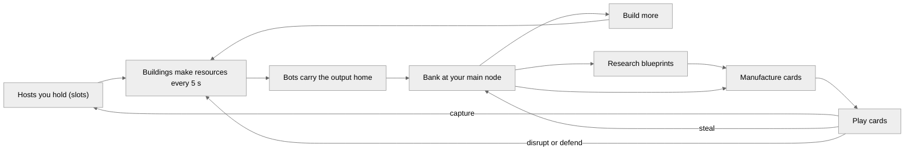
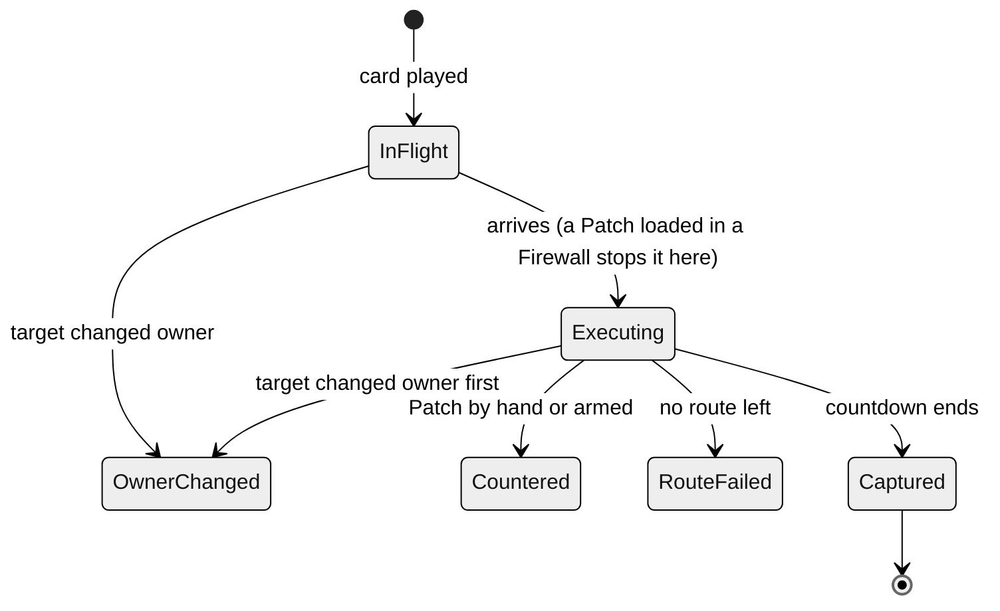

<!-- Generated by docs/tools/build_design.py from the game's config. Edit the tools, not this file. -->

# RIM design reference

The whole design of RIM as the game runs it: flow, map, economy, logistics, every card, defence, winning, the AI, multiplayer and the interface, with derived numbers for analysis. Same content as [design.html](design.html); every constant is in [rim_constants.json](rim_constants.json).

RIM 0.5.0-a · commit 4ad2b11

## Contents

- [Overview and core loop](#overview-and-core-loop)
- [Match flow](#match-flow)
- [Time model](#time-model)
- [Map and network](#map-and-network)
- [Host types](#host-types)
- [Sight and fog](#sight-and-fog)
- [Resources and banks](#resources-and-banks)
- [Production cycle](#production-cycle)
- [Logistics](#logistics)
- [Buildings](#buildings)
- [Research and manufacturing](#research-and-manufacturing)
- [How cards resolve](#how-cards-resolve)
- [Attack cards](#attack-cards)
- [Defence cards](#defence-cards)
- [Firewall](#firewall)
- [Counters](#counters)
- [Winning and elimination](#winning-and-elimination)
- [AI](#ai)
- [Multiplayer](#multiplayer)
- [Interface and controls](#interface-and-controls)
- [Simulation step](#simulation-step)
- [Derived numbers](#derived-numbers)
- [Price table](#price-table)
- [All constants](#all-constants)
- [Unused config](#unused-config)
- [For review](#for-review)


## Overview and core loop

RIM is a real-time strategy game about botnets on a generated city network. Two to four networks (you and 1–3 AI rivals, or 2–3 players online) start in different parts of the town. There are no units to fight with: everything is done with **cards**. You build an economy inside the hosts you own, research card blueprints, manufacture single-use cards, and play them on hosts. Capture cards take hosts, theft cards take resources, disruption cards stop production, defence cards protect. You win by holding 51% of all hosts for 51 s in a row, or by being the last network with a main node.



*The core loop. Every arrow out of a building passes through logistics: a resource can be spent only once it is home.*

- **Everything is delivered.** Output made away from the main node is worth nothing until a Bot carries it home along your own hosts.
- **Cards do all the fighting.** Captures have execution times and succeed unless stopped; theft and disruption have durations; defence answers them.
- **Timing and information.** Fog hides rival hosts; execution countdowns give the defender a window; a Firewall lets you decide the defence in advance.

## Match flow

#### Setup (Skirmish)

- Layout: Spiral (default), Elliptical, Ring or Grid.
- Size: Small 6×4 (≈20 hosts), Medium 8×6 (≈41 hosts), Big 10×8 (≈68 hosts).
- Enemies: 1–3 AI networks (NYX, KRAKEN, VIPER).
- Seed: a number for a repeatable town, blank for a random one.

#### Other modes

**Learn (campaign):** recommended on the first run, never required; Skip for now keeps it one click away. 5 guided chapters on a small grid town: capture, build, research, theft and defence, then an open chapter against an active rival. In the guided chapters captures always succeed.

**Multiplayer:** 2–3 players in a lobby; the galaxy shape comes from the match seed; no AI. See [Multiplayer](#multiplayer).

#### Start state (every network)

- A main node: a Server (3 slots, security 3) with an Intel harvester and a Bot station already built, one slot free.
- One empty PC next to it, already yours.
- Bank: 20 Bots, 40 Intel, 20 Crypto, 15 Creds, 10 Research.
- Known recipes: Recon, Credential breach, Phishing, Patch, Incident response.
- Every other host is neutral (“city security”): no buildings, no defence beyond its security class.

#### Ending

The match ends when one network holds the majority for 51 s or is the last with a main node. In single player, losing your main node loses the match; in multiplayer you are out and the others play on. Space pauses a single-player match; multiplayer never pauses.

| Phase     | Typical time | What happens                                                                                                                                                                                                      |
|-----------|--------------|-------------------------------------------------------------------------------------------------------------------------------------------------------------------------------------------------------------------|
| Opening   | 0–1 min      | Fill the main node's free slot (a converter); lay out the PC (Bot station, Intel harvester, converter); make the first Breach (12 Intel, 12 Credentials: the start bank covers it) and take a first neutral host. |
| Expansion | 1–6 min      | Breach security-1 hosts: each Breach that runs its 15 s takes its host. Credentials run short first, so Credential harvesters come next; research Known exploit (40 s) and build a Lab for its Research price.    |
| Contact   | 5–10 min     | Borders meet. Theft (Phishing, Packet siphon, Vault raid), DDoS and Sabotage on rival hosts; Firewalls with loaded Patch, Response and Filter on key hosts; Known exploit and Worm on security-2 hosts.           |
| End game  | 10 min +     | 0day on databases, ERP systems and rival main nodes (elimination); the race to hold 51% of all hosts for 51 s.                                                                                                    |

Measured sample: four AIs on a Medium spiral (41 hosts) grow from 8 held hosts to about 20 in 6 minutes, resolving ~50 capture attempts.

## Time model

| Clock                       | Value                                 | Notes                                                                                                                                 |
|-----------------------------|---------------------------------------|---------------------------------------------------------------------------------------------------------------------------------------|
| Simulation step             | 1/30 s                                | Fixed step; the screen draws at up to 60 fps (30 in menus or in the background) and never changes the rules.                          |
| Production cycle            | 5 s                                   | Per host, each on its own phase (a host's first cycle comes 1–5 s after the match starts), so the network does not pulse all at once. |
| Main node trickle           | 0.2/s each                            | Continuous: 1 of every resource per 5 s.                                                                                              |
| AI decisions                | every 2.5 s                           | Each AI on its own offset.                                                                                                            |
| Travel                      | 1 s per link + 0.25 s per host passed | Halved by Express route; queues when a link is full.                                                                                  |
| Construction                | 10 s (+5 s to replace)                |                                                                                                                                       |
| Research                    | 30–70 s                               | One at a time.                                                                                                                        |
| Manufacturing               | 3–26 s per copy                       | Three lanes in parallel.                                                                                                              |
| Execution (reaction window) | 10–15 s                               | Breach 15, Known exploit 12, 0day 10 (15 on a main node), Worm 12 per stage, Vault raid 10.                                           |
| Effects                     | 30–60 s                               | Siphon 30, DDoS 45, Phishing 60, Sabotage 60; Filter and Cover 30, Express 45; Recon view 45.                                         |
| Win hold                    | 51 s                                  | Continuous.                                                                                                                           |
| Multiplayer turn            | 0.1 s                                 | 3 steps per turn; commands run 2 turns (0.2 s) after they are sent.                                                                   |

## Map and network

#### Hosts and shapes

About cols × rows × 0.85 hosts (at least 12). Galaxies: a **spiral** with one arm per network and each main node at an arm's tip, a wide **elliptical** disc denser in the middle, or a **ring** with an empty middle; each host is the best of 10 random spots, never closer than 0.85 cells to another. The **grid** places one host per cell with 15% of cells left empty.

Networks start at even angles round the centre (you top-left). Each start is a main node plus one second host.

#### Value and type

Each host gets a value 1–3 from how far it is from every start (galaxy: the nearest third is 1, the middle 2, the farthest 3; grid: distance from the centre), with a 20% chance of ±1. Value picks the host type by the weights below, so the rich, well-defended hosts sit away from every start. A central **hub** (an ERP system) stands in the middle of every layout but the ring.

#### The hidden network

Every two hosts within 1.55 cells (≈295 px) are linked; islands are joined to the main town by their shortest gap. Links are never drawn; a link you have sent anything over becomes a faint **road** on your map for the rest of the match. Rivals' roads are never shown.

#### Junctions

The 2 best-connected mid-town hosts (value 2+, 3+ links, not a start) are junctions: their links carry 16 packets per second per direction instead of 8. Supply lines cross them, which makes them the natural place for a Packet siphon or a DDoS.

| Host value               | IoT device | PC  | Server | Web server | File server | Database | ERP system |
|--------------------------|------------|-----|--------|------------|-------------|----------|------------|
| 1 (near starts)          | 35%        | 40% | 10%    | 10%        | 5%          | ·        | ·          |
| 2                        | ·          | 30% | 20%    | 20%        | 15%         | 15%      | ·          |
| 3 (far from every start) | ·          | ·   | 20%    | 15%        | 20%         | 25%      | 20%        |
| hub                      | ·          | ·   | ·      | ·          | ·           | ·        | always     |

## Host types

| Type        | Slots | Security | Multipliers (output and input)                                      | Who can capture it                |
|-------------|-------|----------|---------------------------------------------------------------------|-----------------------------------|
| IoT device  | 1     | 1        | Credentials ×0.5, Research ×0.5                                     | Breach, Known exploit, 0day, Worm |
| PC          | 3     | 1        | none                                                                | Breach, Known exploit, 0day, Worm |
| Server      | 3     | 2        | Intel ×1.5, Research ×1.5                                           | Known exploit, 0day, Worm         |
| Web server  | 3     | 2        | Intel ×1.5, Credentials ×2                                          | Known exploit, 0day, Worm         |
| File server | 4     | 2        | Intel ×2, Research ×2                                               | Known exploit, 0day, Worm         |
| Database    | 4     | 3        | Intel ×2, Credentials ×1.5, Research ×1.5                           | 0day                              |
| ERP system  | 5     | 3        | Intel ×1.5, Crypto ×1.5, Credentials ×1.5, Research ×1.5, Bots ×1.5 | 0day                              |

- An active main node is always security 3, whatever its type. Nothing else changes security.
- A multiplier scales a building's input too: a Credential harvester on a web server turns 2 Intel into 2 Credentials per cycle; a Bot station on an ERP system makes 3 Bots.
- When a host changes owner its buildings, storage, Firewall cards and effects are wiped, and its ownership generation counts up: operations aimed at the old owner become void.

## Sight and fog

- You see your own hosts and every host linked to one of them. Rival packets, effects and their busy streets show only there.
- Every main node is visible as a landmark, but nothing around it.
- Hosts you saw before stay on the map as dim outlines, without owner or contents; fogged hosts cannot be clicked.
- Security and host type are public. What is inside a rival host (buildings, storage, Firewall cards) is shown only by a fresh Recon (45 s).
- Territories: each held, visible host claims a round patch; one network's patches merge, and the ground between rivals is split halfway.

## Resources and banks

| Resource    | Comes from                                        | Is spent on                                                                                                    |
|-------------|---------------------------------------------------|----------------------------------------------------------------------------------------------------------------|
| Bots        | Bot stations (2 per cycle), the main node trickle | Carrying resources home (a bank courier is used up), carrying Vault-raid loot. No card or building costs Bots. |
| Intel       | Intel harvesters (2 per cycle), the trickle       | Every building, every card, every converter's input, Firewall upkeep, research.                                |
| Crypto      | Crypto miners, the trickle                        | Some buildings, most cards, research, the Lab's input.                                                         |
| Credentials | Credential harvesters, the trickle                | Breach (its focus), Phishing, Packet siphon, Vault raid, 0day, Sabotage, Incident response.                    |
| Research    | Research labs, the trickle                        | Research projects, Known exploit and Worm (their focus), 0day and most advanced cards.                         |

``` code
bank cap(resource) = BASE_CAP[resource] + 50 × (your buildings whose output is that resource)
BASE_CAP = Bots 200, Intel 150, Crypto 300, Credentials 150, Research 150
spendable   = what is in the bank at your main node (nothing else counts)
income      = main-node trickle (1 of each per 5 s, while the main node is held and not under DDoS)
            + building output that reaches the bank
```

Anything that would go over a cap is lost: the trickle and main-node production clamp at the cap, and couriers are not sent to a full bank (shipments on the road reserve their room).

### Accounting: what the rates mean

Every change to a bank is recorded once, with its cause, in one-second buckets over the last 30 s of play. The rates shown are measured, not predicted: what actually reached or left the bank, scaled to a minute. During the first 30 s of a match they are marked as an early estimate (~).

| Kind     | Causes                                                                                                                                                                                                                                                 |
|----------|--------------------------------------------------------------------------------------------------------------------------------------------------------------------------------------------------------------------------------------------------------|
| Received | trickle (the main node), production (buildings on the main node, Bot stations' Bots), delivered (cargo from your hosts), stolen (Phishing, Siphon and Vault-raid loot), returned (a Phishing that ended), refunds (a cancelled build, copy or project) |
| Spent    | buildings, manufacturing, research, couriers (a bank Bot sent to fetch a unit), converters and upkeep (main-node Miners, Labs, Credential harvesters and Firewalls)                                                                                    |
| Lost     | cap (income that arrived at a full bank), cargo (a shipment whose route broke), siphoned (storage drained by a rival's Packet siphon)                                                                                                                  |

``` code
net rate(resource) = (received − spent) over the window × 60 / window seconds
on the road        = shipments in flight to the bank, the next arrival, and how many no longer have a route home
```

Within the window the recorded flows reconcile exactly with the bank. The ledger is presentation only: it is not part of the multiplayer fingerprint.

## Production cycle

``` code
every 5 s, for each held host h (on its own phase):
  beneficiary = the Phishing thief while h is phished, else its owner
  storage     = the beneficiary's bank if h is their main node, else h's storage (10 units, all resources together)

  1. Intel harvesters:  + 2 × m_intel × (active harvesters) Intel into storage, up to its room
  2. Firewalls:         each eats 1 Intel from storage (the owner's first); paid in full → on, else off
  3. Converters, in order Miner → Credential harvester → Lab, each active one:
        frac = min(1, inputs available in storage / inputs needed × m)
        take inputs × m × frac, add 1 × m × frac output
        (Miner 1 Intel → 1 Crypto · Cred. harvester 1 Intel → 1 Credential · Lab 1 Intel + 1 Crypto → 1 Research)
  4. Bot stations:      bots = Σ round(2 × m_bots)
        at the beneficiary's main node: bots go straight into the bank
        elsewhere, if h has a route home and is not under DDoS:
            each Bot takes 1 whole unit from storage (shipping priority first, then in turn) and flies home,
            or flies home empty if the bank has room for it; on arrival the Bot and its unit join the bank

active = built, not under construction, not paused by you, not under DDoS, not sabotaged
m      = the host type's multiplier for that resource
```

| Layout (on a PC, ×1)                                      | Made each cycle                               | Delivered each cycle                     | Net to the bank per minute                               |
|-----------------------------------------------------------|-----------------------------------------------|------------------------------------------|----------------------------------------------------------|
| Bot station + Intel harvester + Miner                     | 2 Intel → 1 Intel + 1 Crypto; 2 Bots          | both units, by the station's Bots        | +24 Bots, +12 Intel, +12 Crypto                          |
| Bot station + Intel harvester + Cred. harvester           | 1 Intel + 1 Credential; 2 Bots                | both units, by the station's Bots        | +24 Bots, +12 Intel, +12 Creds                           |
| Intel harvester + Miner + Lab (Research host)             | 2 Intel → 1 Crypto → with 1 Intel, 1 Research | 1 unit by a bank courier (used up)       | −12 Bots, +12 Research                                   |
| Bot station + 2 Intel harvesters                          | 4 Intel; 2 Bots                               | 2 by the station, 2 by bank couriers     | +48 Intel                                                |
| Intel harvester + Miner + Cred. harvester (no station)    | 1 Crypto + 1 Credential                       | 2 units by bank couriers                 | −24 Bots, +12 Crypto, +12 Creds                          |
| Bot station alone (IoT device)                            | 2 Bots                                        | they walk home                           | +24 Bots                                                 |
| Database: station + harvester + 2 Cred. harvesters        | 4 Intel → 1 Intel + 3 Credentials; 2 Bots     | 2 by the station, 2 by bank couriers     | +12 Intel, +36 Creds                                     |
| Main node (Server): Intel harvester + Bot station + Miner | 3 Intel → 2 Intel + 1 Crypto; 2 Bots          | straight into the bank, plus the trickle | +36 Bots, +36 Intel, +24 Crypto, +12 Creds, +12 Research |
| \+ a Firewall on the host                                 | uses 1 Intel                                  | —                                        | −12 Intel                                                |

### Host status

A selected host's panel names its status from the first problem that applies, in this order. The next-cycle preview is worked out exactly as the cycle will run, so it never shows output the host cannot make.

| Status                   | When                                                                                                                 | What the panel suggests                                                            |
|--------------------------|----------------------------------------------------------------------------------------------------------------------|------------------------------------------------------------------------------------|
| under DDoS               | a DDoS is active here                                                                                                | nothing is made or sent until it ends                                              |
| sabotaged                | a Sabotage is active here                                                                                            | producers are off; cargo still passes                                              |
| phished                  | a rival's Phishing is active here                                                                                    | output goes to them until it ends (Incident response clears it)                    |
| no route                 | no chain of your hosts links it to your main node                                                                    | retake a host between them                                                         |
| starved                  | a converter lacks its input here (a remote host cannot use the bank), or a main-node converter's input bank is empty | build the missing harvester or Miner here, or replace the converter                |
| blocked                  | storage full, or the bank for what is stored (or a main-node converter's output) is at its cap                       | spend that resource, pause the converter, or add a Bot station / lower the reserve |
| waiting for couriers     | units are stored but no Bot is spare above the reserve                                                               | lower the reserve or build a Bot station here                                      |
| Firewall off             | the next cycle cannot pay the Firewall's Intel                                                                       | build an Intel harvester here                                                      |
| paused · building · idle | every producer paused by you · nothing finished yet · nothing installed                                              | —                                                                                  |
| operating                | none of the above                                                                                                    | —                                                                                  |

## Logistics

#### Who carries

A host's Bot stations carry first, in the same cycle. Units left in storage wait for a **bank courier**: every step, each host with a whole unit of a resource sends one if your bank holds Bots above your **reserve** (0, 5, 10, 20 or 40; default 10), the bank has room for it and there is a route home. That Bot leaves the bank and is used up. Hosts are served in turn; your **shipping priority** resource gets 2 turns for every 1 of the others.

#### Routes

Couriers and attack cards travel only through your own hosts and never through one under DDoS (shortest path by links). Stolen goods leave a rival host the way your operation came in. A host with no route home keeps its output in storage until it fills.

#### Speed and capacity

``` code
travel = links × 1 s + hosts passed × 0.25 s   (× 0.5 with Express route)
each link direction admits 8 packets per second (16 on a junction's links); extra packets wait
```

#### Losses

A courier whose route has lost a host it passed (captured, or under DDoS) by the time it arrives is lost with its cargo. Packet siphon turns couriers round; Courier cover protects them.

## Buildings

| Building             | Each cycle                        | Build price         | Bank cap         | Rules                                                                                                                                                                                                                                                                                                                                |
|----------------------|-----------------------------------|---------------------|------------------|--------------------------------------------------------------------------------------------------------------------------------------------------------------------------------------------------------------------------------------------------------------------------------------------------------------------------------------|
| Intel harvester      | +2 Intel                          | 12 Intel            | +50 Intel cap    | Feeds the converters on its own host first; the rest is stored.                                                                                                                                                                                                                                                                      |
| Bot station          | +2 Bots                           | 12 Intel, 4 Crypto  | +50 Bots cap     | Its 2 Bots leave at once, each carrying 1 unit from the host’s storage (your shipping priority first, then in turn), and join your Bot bank on arrival. With nothing to carry they still come home, if your Bot bank has room. With no route home (or under DDoS) no Bots are made. At the main node they go straight into the bank. |
| Crypto miner         | −1 Intel → +1 Crypto              | 15 Intel            | +50 Crypto cap   | Uses Intel from its own host’s storage only (the bank, at the main node).                                                                                                                                                                                                                                                            |
| Credential harvester | −1 Intel → +1 Creds               | 15 Intel, 4 Crypto  | +50 Creds cap    | Uses Intel from its own host’s storage only.                                                                                                                                                                                                                                                                                         |
| Research lab         | −1 Intel, −1 Crypto → +1 Research | 20 Intel, 8 Crypto  | +50 Research cap | Uses Intel and Crypto from its own host only: put a Miner beside it, or build it at the main node.                                                                                                                                                                                                                                   |
| Firewall             | −1 Intel upkeep                   | 25 Intel, 15 Crypto | —                | Not a producer. 3 sockets for defence cards per Firewall. Eats 1 Intel from its own host each cycle, before any converter; without it the Firewall is off and its cards wait. Adds no security.                                                                                                                                      |

- Drag a building card from the host panel onto a slot. The full price is paid when the job starts; the job takes 10 s. Replacing a building first demolishes it (5 s).
- Click a producer to pause or resume it; a job can be paused or cancelled.
- Every building of a resource's kind adds 50 to that resource's bank cap (the Firewall adds nothing).

## Research and manufacturing

#### Research (RESEARCH tab)

The tab shows the tree: every recipe under the one it is researched from, marked known, researching, open or locked. One blueprint at a time. Its price is paid bit by bit over its research time and it waits whenever a resource runs short. Click it again to pause; cancelling stops the payments (what was paid is spent). Research unlocks the recipe; it gives no card.

#### Manufacturing (ATTACK and DEFENCE tabs)

These tabs hold only the recipes you know. Click a card to make a copy in one of three lanes: its whole price is paid when it starts, then it takes its make time. A lane can Repeat. Ready copies plus copies being made: at most 12. Copies never expire.

| Blueprint             | Needs             | Price and time                         | Early · mid wait |
|-----------------------|-------------------|----------------------------------------|------------------|
| Known exploit         | Credential breach | 24 Intel, 4 Crypto, 20 Research, 40 s  | 100 s · 50 s     |
| 0day                  | Known exploit     | 48 Intel, 12 Crypto, 50 Research, 70 s | 250 s · 125 s    |
| Worm                  | Known exploit     | 36 Intel, 8 Crypto, 36 Research, 55 s  | 180 s · 90 s     |
| DDoS                  | Recon             | 24 Intel, 4 Crypto, 18 Research, 35 s  | 90 s · 45 s      |
| Supply-chain sabotage | DDoS              | 40 Intel, 12 Crypto, 44 Research, 60 s | 220 s · 110 s    |
| Packet siphon         | Phishing          | 24 Intel, 4 Crypto, 20 Research, 40 s  | 100 s · 50 s     |
| Vault raid            | Packet siphon     | 36 Intel, 8 Crypto, 40 Research, 55 s  | 200 s · 100 s    |
| Traffic filter        | Patch             | 18 Intel, 4 Crypto, 14 Research, 30 s  | 70 s · 35 s      |
| Courier cover         | Patch             | 18 Intel, 4 Crypto, 14 Research, 30 s  | 70 s · 35 s      |
| Express route         | Recon             | 24 Intel, 4 Crypto, 20 Research, 35 s  | 100 s · 50 s     |

## How cards resolve

#### Playing an attack card

- Target: a foreign host (neutral or a rival's).
- Reachable: you hold a host linked to the target and a path of your hosts from your main node to it (or the target is linked to your main node).
- Your main node must not be under DDoS.
- One capture or raid per attacker per host at a time.

#### Flight and arrival

The card flies from your main node along that path. It always arrives (the route is checked again when it resolves), unless the target changed owner on the way: then it is void. Effects (Recon, Phishing, Siphon, DDoS, Sabotage) apply on arrival. **Intrusions** (captures, Worm stages, Vault raid) start an execution countdown that the owner sees on the host.

#### When an execution ends

Intrusions resolve earliest end first, equal end times in launch order. Each ends in exactly one outcome, with its own message: an armed Patch stops it (**countered**); a target that changed owner first voids it (**owner changed**; a host can never be captured twice from the same generation); no path left fails it (**route failed**). Otherwise it is **captured**: the host is yours, wiped. There is no roll. Commands accepted for a step (a manual Patch included) apply before that step's intrusions resolve.

#### Defence cards

Played on one of your own hosts; they act at once, wherever the host is, even cut off or under DDoS. Patch, Incident response, Traffic filter and Courier cover load into a free Firewall socket instead, unless their attack is already there.



*The life of a capture card.*

## Attack cards

“≈ early · mid” is the price in seconds of income on the resource that runs out first, for the two reference networks in [Derived numbers](#derived).

### Recon

`ATTACK` `Known from the start`

Reveal a host's contents for 45 s.

**Make:** 8 Intel, 3 s (≈ 10 s early · 6 s mid of Intel income)

- **Why it exists:** Tells you whether an expensive card will pay off: what a host holds, how full its storage is, and whether a Patch waits in its Firewall.
- **Play it when:** Before an 0day, Vault raid, Worm or Sabotage, or to find a rival's richest host.
- **Target:** Any foreign host your operations can reach.
- **Timing:** Travels, then takes effect on arrival. No execution.
- **Effect:** Takes a snapshot of the host: what is in each slot, how full its storage is, and which cards wait in its Firewall. You see the snapshot, not later changes, for 45 s; then the slots go back to “?”.
- **Quiet:** The target gets no red frame and no pulse. It is the only attack card that does not show.
- **Not needed for:** Capture. Security is always public.

### Credential breach

`ATTACK` `Known from the start`

Capture a security-1 host.

**Make:** 12 Intel, 12 Creds, 12 s (≈ 60 s early · 20 s mid of Credentials income)

- **Why it exists:** The way to grow: every host adds slots, and holding 51% of all hosts wins.
- **Play it when:** Whenever security-1 hosts are in reach; neutral hosts first, as nobody defends them.
- **Target:** A foreign host of security ≤ 1: PCs and IoT devices, neutral or a rival’s.
- **Timing:** Travels, then executes for 15 s on the host. The owner sees “Breach executing” and has that long to react.
- **Outcome:** When its execution ends the host is captured. Before that it can only be stopped, each way with its own message: a Patch (**countered**), losing your path to it (**route failed**), or another owner taking it first (**owner changed**). There is no roll.
- **Effect:** On success the host becomes yours. All of its buildings, storage, Firewall cards and running effects are wiped: you start with empty slots.
- **Stopped by:** A Patch (by hand during execution, armed in advance, or loaded in a Firewall: then it never starts), losing your path to a neighbour of the host, or the host changing owner meanwhile.
- **Limit:** One capture or raid per attacker per host at a time.

### Known exploit

`ATTACK` `Research after Credential breach`

Capture a host up to security 2.

**Make:** 14 Intel, 12 Research, 14 s (≈ 60 s early · 30 s mid of Research income)

- **Why it exists:** Opens the first rich hosts: servers, web servers and file servers.
- **Play it when:** When the security-1 hosts near you are gone.
- **Target:** A foreign host of security ≤ 2: also servers, web servers and file servers.
- **Timing:** Travels, then executes for 12 s.
- **Outcome:** As Credential breach: captured when its execution ends unless countered, route-failed or owner-changed.
- **Effect:** As Credential breach: the host becomes yours, wiped.
- **Stopped by:** As Credential breach.

### 0day

`ATTACK` `Research after Known exploit`

Capture a host up to security 3.

**Make:** 16 Intel, 12 Crypto, 12 Creds, 16 Research, 26 s (≈ 80 s early · 40 s mid of Research income)

- **Why it exists:** The only card that takes databases, ERP systems and main nodes, so the only way to knock a rival out.
- **Play it when:** After a Recon shows no Patch waiting, or after a cheaper card has used it up.
- **Target:** Any foreign host (security ≤ 3): also databases, ERP systems and a rival’s active main node.
- **Timing:** Travels, then executes for 10 s; 15 s on an active rival main node, with a countdown the owner sees.
- **Outcome:** As Credential breach: captured when its execution ends unless countered, route-failed or owner-changed.
- **Effect:** The host becomes yours, wiped. On a rival main node the rival is eliminated: their banks and cards are cleared, their flights vanish, and every other host they held becomes neutral with empty slots. You keep the old main node as an ordinary host.
- **Stopped by:** As Credential breach.

### Worm

`ATTACK` `Research after Known exploit`

Known exploit on 2 linked hosts.

**Make:** 24 Intel, 24 Research, 22 s (≈ 120 s early · 60 s mid of Research income)

- **Why it exists:** Three Known exploits in one launch, reaching hosts behind a rival's front line.
- **Play it when:** When a rival holds a chain of hosts of security 2 or less.
- **Target:** A foreign host of security ≤ 2 that your operations can reach.
- **What it is:** Known exploit on up to 2 linked hosts, one after the other.
- **Timing:** Travels; each stage executes for 12 s, and each can be stopped on its own.
- **Chain:** Once the first host is captured, the second stage starts on the nearest (by map distance, then host number) visible host linked to it that belongs to the **same owner** as the first target and has security ≤ 2. It never jumps to another owner.
- **Stops when:** A stage is countered by a Patch, its route is lost, its host changes owner, or no such neighbour exists. A stopped stage ends the chain; a stage already captured stays captured.

### Phishing

`ATTACK` `Known from the start`

Divert new output for 60 s.

**Make:** 18 Intel, 6 Crypto, 8 Creds, 4 Research, 12 s (≈ 40 s early · 13 s mid of Credentials income)

- **Why it exists:** Hurts a rival without taking ground: you gain exactly what they lose.
- **Play it when:** On their best-producing host.
- **Target:** A foreign host (a rival’s; a neutral host makes nothing).
- **Timing:** Takes effect on arrival, for 60 s.
- **Effect:** Everything the host makes is yours: its harvesters and converters work for you from its storage, and its Bot stations’ couriers carry the output to **your** main node and join your Bots. Units left in its storage for you are fetched by your bank couriers.
- **Victim:** Keeps the host but gets nothing from it. Its main-node trickle (if you phish a main node) still goes to them.
- **Ends:** After its time, or when Incident response clears it. Your unsent stolen units on the host then go back to the owner.

### Packet siphon

`ATTACK` `Research after Phishing`

Hijack couriers crossing a host.

**Make:** 20 Intel, 6 Crypto, 6 Creds, 5 Research, 12 s (≈ 30 s early · 14 s mid of Credentials income)

- **Why it exists:** Takes a whole supply line, not one host's output.
- **Play it when:** On a host their deliveries cross, set to the resource they need most.
- **In one line:** A tap on one of their hosts: for a while, their deliveries that go through it come to you instead.
- **Target:** A rival host their deliveries leave from or pass through (a junction is best). You pick the resource (Intel, Crypto, Credentials or Research) in the host’s Launch panel; a card dragged onto the map takes Crypto.
- **Timing:** Takes effect on arrival, for 30 s.
- **Effect:** Every courier carrying that resource that leaves or passes the host after the siphon lands turns round and carries it to your main node, along your operation’s route. Up to 30 couriers. A Bot-station courier joins your Bots too; a bank courier is used up as usual.
- **Not affected:** Covered cargo (Courier cover), empty station Bots, your own cargo.
- **Ends:** After its time, after its last courier, or when Incident response clears it.

### Vault raid

`ATTACK` `Research after Packet siphon`

Empty the storage of 3 linked hosts.

**Make:** 24 Intel, 10 Creds, 8 Research, 16 s (≈ 50 s early · 20 s mid of Credentials income)

- **Why it exists:** Punishes a network whose output piles up in storage.
- **Play it when:** On hosts with no Bot station, no spare couriers or no route home.
- **Target:** Any rival host.
- **Timing:** Travels, then executes for 10 s.
- **Effect:** Takes everything stored on the target and on its 2 nearest linked hosts of the same owner, up to 30 units, all resources. It travels home on your Bots, one Bot per unit (used up), so it is also capped by your Bots above the reserve and your free bank room. A main node keeps its output in the bank, so it adds nothing.
- **Best on:** Hosts whose output piles up: no Bot station, no couriers to spare, or no route home.
- **Stopped by:** A Patch on the target, or your operation having no way home.

### DDoS

`ATTACK` `Research after Recon`

Halt 3 hosts' output for 45 s.

**Make:** 34 Intel, 14 Crypto, 5 Research, 14 s (≈ 42 s early · 24 s mid of Intel income)

- **Why it exists:** The only card that hits logistics: it strands supply lines and, on a main node, stops their attacks.
- **Play it when:** Right before your own big attack, or on the hosts their supply lines share.
- **Target:** Any foreign host.
- **Timing:** Takes effect on arrival, for 45 s.
- **Reach:** The target and its owner’s 2 hosts nearest to it on the map, all at once.
- **Effect:** Each one makes nothing, sends nothing and forwards nothing. New routes go round them. Couriers whose route runs through one and arrive while it is down are lost. Cargo addressed to them still arrives.
- **On a main node:** Its one-of-each trickle and its producers stop, and its owner cannot launch any attack card until it ends.
- **Blocked by:** Traffic filter, host by host: a host under Filter ignores it; a Filter loaded in its Firewall fires and the DDoS never lands there.

### Supply-chain sabotage

`ATTACK` `Research after DDoS`

Shut producers on 3 hosts for 60 s.

**Make:** 36 Intel, 12 Crypto, 8 Creds, 14 Research, 22 s (≈ 70 s early · 35 s mid of Research income)

- **Why it exists:** Shuts a district's production for a minute without touching its logistics.
- **Play it when:** On their production cluster before a long fight.
- **Target:** A rival host.
- **Timing:** Takes effect on arrival, for 60 s.
- **Effect:** Switches off every producer on the target and on up to 2 more hosts of the same owner, each the nearest neighbour of the last. Routing, couriers and Firewalls keep working; a main node keeps its trickle.
- **Cleared by:** Incident response, host by host (a Response loaded in a hit host’s Firewall clears that host at once).

## Defence cards

### Patch

`DEFENCE` `Known from the start` `Firewall socket`

Stop a capture or a raid.

**Make:** 12 Intel, 4 Crypto, 3 Research, 8 s (≈ 15 s early · 9 s mid of Intel income)

- **Why it exists:** Every capture has a countdown; Patch is the answer to it.
- **Play it when:** On a host under intrusion, or loaded at your main node.
- **Target:** One of your hosts.
- **By hand:** Cancels the capture, Worm stage or Vault raid running there that ends first. With nothing running, it arms the host for 30 s: the next one that would finish there in that time is blocked instead.
- **Loaded:** In a free Firewall socket it waits with no time limit and stops the next capture, Worm stage or Vault raid the moment it starts executing there.

### Incident response

`DEFENCE` `Known from the start` `Firewall socket`

Clear theft and sabotage here.

**Make:** 12 Intel, 3 Crypto, 3 Creds, 2 Research, 6 s (≈ 15 s early · 9 s mid of Intel income)

- **Why it exists:** Theft and sabotage last a minute; this ends them.
- **Play it when:** On a host being phished, siphoned or sabotaged, or loaded where theft is likely.
- **Target:** One of your hosts.
- **By hand:** Ends Phishing, Packet siphon and sabotage on that host at once. Stolen units not yet sent come back to you. It does not clear DDoS, and with nothing to clear it does nothing.
- **Loaded:** Fires the moment Phishing, a siphon or sabotage lands on that host, so nothing is stolen or switched off.

### Traffic filter

`DEFENCE` `Research after Patch` `Firewall socket`

Clear DDoS and block it for 30 s.

**Make:** 14 Intel, 4 Crypto, 2 Research, 8 s (≈ 18 s early · 10 s mid of Intel income)

- **Why it exists:** DDoS is the strongest disruption and needs its own answer.
- **Play it when:** Loaded on a junction or on your main node.
- **Target:** One of your hosts.
- **By hand:** Clears a DDoS there and makes the host ignore DDoS for 30 s.
- **Loaded:** Fires when a DDoS lands: the DDoS never takes effect and the host is immune for the same 30 s.

### Courier cover

`DEFENCE` `Research after Patch` `Firewall socket`

Shield this host's cargo for 30 s.

**Make:** 12 Intel, 4 Crypto, 2 Research, 8 s (≈ 15 s early · 9 s mid of Intel income)

- **Why it exists:** Protects a supply line from the sending side.
- **Play it when:** On hosts whose couriers cross a siphoned host.
- **Target:** One of your hosts.
- **By hand:** For 30 s every courier that host sends (and those already on the road from it) cannot be siphoned anywhere on its way home.
- **Loaded:** Fires when a siphon grabs one of this host’s couriers: that courier is saved, and cover starts for 30 s.

### Express route

`DEFENCE` `Research after Recon`

Halve delivery time for 45 s.

**Make:** 14 Intel, 4 Crypto, 2 Research, 10 s (≈ 18 s early · 10 s mid of Intel income)

- **Why it exists:** A shorter road: deliveries arrive sooner and spend less time in reach of siphons and cuts.
- **Play it when:** On far producers, or while a siphon threatens your lines.
- **Target:** One of your hosts.
- **Effect:** For 45 s, station couriers, bank couriers and new Bots leaving that host cross each link in half the time (0.5 s instead of 1 s, forwarding 0.125 s instead of 0.25 s).
- **Not loadable:** It cannot go in a Firewall socket.

## Firewall

#### What it is for

It adds no security. It holds defence cards that fire on their own when an enemy card hits the host, so a host is defended while you look elsewhere and faster than anyone can react by hand.

#### Loading

Each finished Firewall gives its host 3 sockets (a host may hold several Firewalls). Playing Patch, Incident response, Traffic filter or Courier cover on a host with a free socket loads the card, unless the attack it answers is already there: then it acts at once. Express route cannot be loaded.

#### Power

Each Firewall eats 1 Intel from its own host every cycle, before any converter. Without it the Firewall is off and its cards wait. Demolishing a Firewall loses the cards it held; capturing the host wipes them. A rival's Recon shows what is loaded.

| Loaded card       | Fires when                                                       | Result                                                          |
|-------------------|------------------------------------------------------------------|-----------------------------------------------------------------|
| Patch             | a capture, Worm stage or Vault raid starts executing on the host | it is stopped before its countdown begins                       |
| Incident response | Phishing, Packet siphon or sabotage lands on the host            | it ends at once; nothing is stolen or switched off              |
| Traffic filter    | a DDoS lands on the host                                         | the DDoS never takes effect; immune to DDoS for 30 s            |
| Courier cover     | a siphon grabs one of this host's couriers                       | that courier is saved; the host's couriers are covered for 30 s |

## Counters

| Attack                        | By hand                                                   | Loaded in a Firewall         | Other answers                                     |
|-------------------------------|-----------------------------------------------------------|------------------------------|---------------------------------------------------|
| Breach · Known exploit · 0day | Patch during execution                                    | Patch: stopped as it starts  | cut the attacker's route; take the host first     |
| Worm                          | Patch on the host it is executing on                      | Patch on either chain host   | cut its route                                     |
| Vault raid                    | Patch on the target                                       | Patch on the target          | keep storage empty (Bot stations, spare couriers) |
| Phishing                      | Incident response                                         | Response: ends it on landing |                                                   |
| Packet siphon                 | Response on the siphoned host; Cover on the sending hosts | Response or Cover            | Express route; route around it                    |
| DDoS                          | Traffic filter, host by host                              | Filter: never lands          |                                                   |
| Sabotage                      | Incident response, host by host                           | Response per host            |                                                   |
| Recon                         | —                                                         | —                            | none; it is silent                                |

## Winning and elimination

``` code
majority = ceil(0.51 × all hosts)
a network that holds ≥ majority hosts for 51 s in a row wins (the timer resets the moment it drops below)
a network with no hosts left is out; the last network with hosts wins
the HUD, standings, Help and the result all read one function (_objective) for these numbers
losing your main node = elimination: your bank, cards, research and flights are cleared,
                        every other host you held becomes neutral with empty slots,
                        the captor keeps the old main node as an ordinary host
```

## AI

One AI for every rival, no difficulty setting. It plays by the same rules, prices, delivery and lanes, and thinks every 2.5 s in this order:

#### 1 · Develop

- Main node: Intel harvester, Bot station, then a converter chosen by need (it may be a Lab, fed from the bank), Lab, Credential harvester.
- Other hosts: 1 slot → Bot station; else Bot station, Intel harvester, converter, converter, Intel harvester.
- A Research host (Intel harvester, Miner, Lab) once it holds 3 hosts or needs Known exploit; on 4-slot hosts a Miner and Lab replace the converters.
- One Firewall on a 4+-slot host once it holds 6 hosts.
- Converter choice: what its next capture card lacks for two copies, else the emptiest bank. It builds the first planned slot it can pay for and saves for the rest.
- Retool: when one of Intel, Crypto, Credentials is ≥ 40% full and another \< 15%, it rebuilds one producer of the full kind as the short kind.

#### 2 · Research

Known exploit at once; then Traffic filter, DDoS, 0day, Worm, Packet siphon, Courier cover, Sabotage, Vault raid, Express route, each only when its whole price is in the bank 1.5 times over.

#### 3 · Manufacture

The cheapest known capture card that cracks the softest reachable host (up to 3 held); a Patch (2 when one of its hosts is under attack); Response or Filter while a Firewall socket is free; one DDoS or Phishing when a target exists.

#### 4 · Operate and defend

Launches up to 3 captures at the softest, then nearest, reachable hosts; Phishing and DDoS on the reachable rival host with the most producers; Patch on an intrusion against its hosts; spare Response, Filter and Patch go into free sockets.

Limits worth knowing: the AI never plays Recon, Packet siphon, Vault raid, Worm, Sabotage, Courier cover or Express route (it may research some). When it picks a Phishing or DDoS target it counts the producers on rival hosts without a Recon, so it sees more than a player would.

## Multiplayer

- 2–3 players; lobbies public or by 5-letter code; sizes Small, Medium, Big; players meet only on the same game version.
- Deterministic lockstep: the server never simulates. Every screen runs the same simulation from the same seed; only commands travel, grouped in turns of 3 steps (0.1 s) and run 2 turns after they are sent.
- Commands: build, demolish, job (pause or resume a job), cancel (a job), produce (pause or resume a producer), research, cancel_research, card (play a card on a host, with a resource for a siphon), card_action (click a card: research or make it), lane_set, lane_make, lane_repeat, lane_cancel, reserve, priority.
- After every turn each screen fingerprints the whole simulation (time, flights, intrusions, every host's owner, buildings, jobs, storage, sockets, Firewall power, cycle phase and timed effects, every bank, courier count, reserve, incoming, cards, known recipes, research and lanes) so drift is caught.
- No pause; a player whose main node falls is out and the others play on.

## Interface and controls

#### Screen

- **HUD** (top): the five banks with cap and incoming arrows, each with its measured net rate per minute underneath (hover for received, spent and lost by cause); to their right the objective, always visible: hosts needed of the total, yours, and who holds the majority with the seconds left.
- **Economy** (top-bar button, a click on the banks, or **E**): per resource, the stock, net rate, where it came from, what it was spent on, what is on the road with the next arrival and any at risk, and what was lost.
- **Map**: hosts (with slot counts), territories, roads, packets, effects.
- **Sidebar**: standings when idle; your host's panel when selected, in this order: role and status (e.g. RESEARCH HOST · starved), each problem with its cause and a fix, the next cycle as it will really run (and, when that falls short, the output at full capacity), delivery (route home with hops, travel and queueing, who carries, storage, what reached the bank from this host recently), then installations, Firewall sockets and the build palette; on the main node also logistics: reserve and shipping priority. A foreign host's panel shows its security, Recon view and the Launch row.
- **Target preview**: on a foreign host's panel (the verdict beside Launch) and beside the cursor while a card is dragged over a host: can it launch and why not; security and eligibility; route, hops and arrival time; execution time and what stops it; the hosts a DDoS, Sabotage or Vault raid would hit, and the Worm's next host, as far as you can see; an armed Patch or a Filter in place; the last Recon of its Firewall with its age (loaded cards are otherwise unknown). Nothing is spent until you launch.
- **Events**: a strip at the bottom-left of the map shows up to four entries, most urgent first: **!** needs you now (an intrusion on your main node, hosts cut off from it, a rival holding the majority), **›** worth acting on (an intrusion or an attack effect on another host, a Firewall without Intel, couriers held at the reserve, research that cannot pay, a lost shipment, your operation stopped), **·** news (a capture, a defence that fired, a blueprint learned, a copy made, a condition that ended). A lasting condition is one entry that counts down and then ends; repeated news counts up. Clicking an entry finds its host; **H** opens the full history (the last 80, with times).
- **Route inspection**: the selected host's links you can see are drawn; for your own host also its route home (green, chevrons pointing home) with a tag giving hops and seconds, or, with no route, its cut-off hosts ringed in red. Nothing hidden by fog is drawn.
- **Deck** (bottom): ATTACK and DEFENCE tabs (known recipes: click to make, drag a copy onto a host to play), RESEARCH tab (the tree). Pushed down it is one strip of mini cards; pulled up it shows four big cards or the tree.
- **Menu** (Esc): Resume, Learn (the guided campaign; recommended until finished or skipped), Skirmish, Multiplayer, Help (six illustrated pages), Feedback, Exit. Nothing is locked behind the campaign.

#### Controls

- Click a host: select (yours) or inspect (foreign). Shift-drag: box-select.
- Drag empty map: pan · wheel: zoom · middle-drag: pan · **0**: recentre.
- **C**: pull the deck up or down · **E**: Economy overview · **H**: event history · **Space**: pause (single player) · **Esc**: menu or clear selection.
- Drag a card onto a host to play it; drag a building card onto a slot to build.

## Simulation step

``` code
every 1/30 s:
  1  deliveries that are due land (cargo credited or lost, operations arrive: effects apply, intrusions start)
  2  construction jobs advance and finish
  3  research advances (paying as it goes)
  4  manufacturing lanes advance; pending copies start if affordable
  5  intrusions whose countdown ended resolve, earliest end first, then launch order (armed Patch, owner, route; else captured)
  6  production: main-node trickle; each host's 5-s cycle when its phase comes round
  7  dispatch: bank couriers for what waits in storage
  8  Packet siphons turn couriers leaving or passing their host
  9  timed effects expire (an ended Phishing returns unsent stolen units)
  10 AI decisions (each AI every 2.5 s)
  11 main-node losses → eliminations; the majority-hold timers; last-network check
```

## Derived numbers

Reference networks used for every “seconds of income” figure on this page:

| Network         | Layout                                                                                           | Bots | Intel | Crypto | Creds | Res. |
|-----------------|--------------------------------------------------------------------------------------------------|------|-------|--------|-------|------|
| Early (≈ 2 min) | main node \[Intel harvester, Bot station, Miner\] + 1 PC \[Bot station, Intel harvester, Miner\] | 60   | 48    | 36     | 12    | 12   |
| Mid (≈ 6 min)   | the same main node + 2 PCs with a Cred. harvester, 2 with a Miner, 1 Lab host                    | 120  | 84    | 48     | 36    | 24   |

per minute; the trickle is included

### What a capture costs

| Card              | Price per copy                             | Make | Execution (reaction window) | Early · mid seconds of income           |
|-------------------|--------------------------------------------|------|-----------------------------|-----------------------------------------|
| Credential breach | 12 Intel, 12 Creds                         | 12 s | 15 s                        | 60 s (Credentials) · 20 s (Credentials) |
| Known exploit     | 14 Intel, 12 Research                      | 14 s | 12 s                        | 60 s (Research) · 30 s (Research)       |
| 0day              | 16 Intel, 12 Crypto, 12 Creds, 16 Research | 26 s | 10 s (15 s on a main node)  | 80 s (Research) · 40 s (Research)       |
| Worm              | 24 Intel, 24 Research                      | 22 s | 12 s per stage, 2 stages    | 120 s (Research) · 60 s (Research)      |

### What buildings add

| Building             | Price               | Each cycle                                                 | What it is worth                                                                          |
|----------------------|---------------------|------------------------------------------------------------|-------------------------------------------------------------------------------------------|
| Intel harvester      | 12 Intel            | +2 Intel (+3 on a Server, +4 on a database or file server) | Raw input: everything else converts it.                                                   |
| Bot station          | 12 Intel, 4 Crypto  | +2 Bots that carry 2 units home and join the bank          | Saves the 2 bank couriers those units would consume.                                      |
| Crypto miner         | 15 Intel            | +1 Crypto, uses 1 Intel on its host                        | Turns Intel into Crypto: worth it only while Crypto limits your plan.                     |
| Credential harvester | 15 Intel, 4 Crypto  | +1 Credential, uses 1 Intel on its host                    | The capture and theft budget early in a match.                                            |
| Research lab         | 20 Intel, 8 Crypto  | +1 Research, uses 1 Intel and 1 Crypto on its host         | Needs a Miner beside it away from the main node; its output usually rides a bank courier. |
| Firewall             | 25 Intel, 15 Crypto | 3 sockets; uses 1 Intel on its host                        | Returns nothing directly: its value is what its loaded cards stop.                        |

### Theft and denial yields

| Card                 | Typical result                                                                                                                     | Upper bound                |
|----------------------|------------------------------------------------------------------------------------------------------------------------------------|----------------------------|
| Phishing (60 s)      | On a Bot station + Intel harvester + converter PC: 12 cycles × (1 Intel + 1 converted + 2 Bots) = 48 units to you, 48 lost to them | A 4-slot ×2 host: ~2× that |
| Packet siphon (30 s) | Every courier of the chosen resource crossing the host; on a junction behind 3–5 producing hosts, ~1 unit per host per cycle       | 30 couriers                |
| Vault raid           | Whatever waits in 3 linked storages; near 0 where stations ship every cycle                                                        | 30 units                   |
| DDoS (45 s)          | 3 hosts × 9 cycles × ~4 units ≈ 100 units never made; on a main node also its trickle and its attacks                              | plus cargo lost through it |
| Sabotage (60 s)      | 3 linked hosts × 12 cycles × 2–4 units ≈ 70–140 units never made                                                                   |                            |

## Price table

| Card                  | Intel | Crypto | Creds | Res. | Make | Early              | Mid                |
|-----------------------|-------|--------|-------|------|------|--------------------|--------------------|
| Recon                 | 8     | ·      | ·     | ·    | 3 s  | 10 s (Intel)       | 6 s (Intel)        |
| Credential breach     | 12    | ·      | 12    | ·    | 12 s | 60 s (Credentials) | 20 s (Credentials) |
| Known exploit         | 14    | ·      | ·     | 12   | 14 s | 60 s (Research)    | 30 s (Research)    |
| 0day                  | 16    | 12     | 12    | 16   | 26 s | 80 s (Research)    | 40 s (Research)    |
| Worm                  | 24    | ·      | ·     | 24   | 22 s | 120 s (Research)   | 60 s (Research)    |
| Phishing              | 18    | 6      | 8     | 4    | 12 s | 40 s (Credentials) | 13 s (Credentials) |
| Packet siphon         | 20    | 6      | 6     | 5    | 12 s | 30 s (Credentials) | 14 s (Intel)       |
| Vault raid            | 24    | ·      | 10    | 8    | 16 s | 50 s (Credentials) | 20 s (Research)    |
| DDoS                  | 34    | 14     | ·     | 5    | 14 s | 42 s (Intel)       | 24 s (Intel)       |
| Supply-chain sabotage | 36    | 12     | 8     | 14   | 22 s | 70 s (Research)    | 35 s (Research)    |
| Patch                 | 12    | 4      | ·     | 3    | 8 s  | 15 s (Intel)       | 9 s (Intel)        |
| Incident response     | 12    | 3      | 3     | 2    | 6 s  | 15 s (Intel)       | 9 s (Intel)        |
| Traffic filter        | 14    | 4      | ·     | 2    | 8 s  | 18 s (Intel)       | 10 s (Intel)       |
| Courier cover         | 12    | 4      | ·     | 2    | 8 s  | 15 s (Intel)       | 9 s (Intel)        |
| Express route         | 14    | 4      | ·     | 2    | 10 s | 18 s (Intel)       | 10 s (Intel)       |

## All constants

Every constant in the game's config files (`scripts/botnet_cfg/*.gd`) plus the engine values, as JSON. The same file is in the project at `docs/rim_constants.json` (not committed: the repository keeps only game files).

The data: [rim_constants.json](rim_constants.json).

## Unused config

Constants still defined in the config files that the current game never reads, left from earlier designs. Changing them has no effect.

| File         | Constants                                                                                                                                                                                                                       |
|--------------|---------------------------------------------------------------------------------------------------------------------------------------------------------------------------------------------------------------------------------|
| buildings.gd | `BUILD_COST_INTEL`                                                                                                                                                                                                              |
| cards.gd     | `FAMILY_NAME`                                                                                                                                                                                                                   |
| factions.gd  | `AI_PROFILE`, `AI_MAX_STREAMS`, `AI_RESERVE`, `AI_PATIENCE`, `AI_SPEED`, `AI_CASH_MULT`, `AI_ASSAULT_PCT`, `AI_CRYPTO_WAIT`, `AI_REACT`, `AI_PRIOR_BOTNET`, `AI_SCOUT_INTEL`, `AI_CHOKE_LEAD`, `AI_EDGE_MEMORY`, `AI_SIEGE_MAX` |
| town.gd      | `LINK_INTEL`, `TOWN_WORDS`                                                                                                                                                                                                      |
| tuning.gd    | `MAX_QUEUE`, `RESEARCH_SLOTS`                                                                                                                                                                                                   |

Also: `NODE_TYPES[…].sec` in types.gd is not read (security comes from `SEC_BY_TYPE`, which rates a file server 2, not 3); `BUILD_TIME` and `DEMOLISH_TIME` exist in both tuning.gd and buildings.gd and only the buildings.gd values are used; there is one research slot whatever `RESEARCH_SLOTS` says.

## For review

Choices made in the last rounds that are worth a second look.

1.  **Firewall (confirmed):** it adds no security; it holds defence cards that fire against enemy cards. A host can hold more than one Firewall; each adds 3 sockets and 1 Intel of upkeep.
2.  **Cards cost no Bots:** Bots only carry resources. Their old Bot price moved to Intel; DDoS, which was priced in Bots, now costs 34 Intel and 14 Crypto.
3.  **Deterministic capture (Milestone A):** no capture roll. An eligible capture that runs its execution succeeds unless countered, route-failed or owner-changed. Breach 12 Intel + 12 Credentials, Known exploit 14 Intel + 12 Research, 0day 16/12/12/16, Worm 2 stages: these are experimental starting values to playtest, not measured balance.
4.  **Vault raid on storage** only pays where output piles up. A network with Bot stations everywhere keeps little in storage.
5.  **Loading beats acting.** On a host with a free socket, a Traffic filter or Courier cover played early is loaded rather than started, so its 30 s of protection begins only when the attack comes.
6.  **DDoS on a junction destroys cargo** already routed through it that arrives while it is down, not just new traffic.
7.  **An eliminated network's hosts go neutral** with empty slots; the captor keeps only the old main node.
8.  **Packet siphon dragged onto the map takes Crypto.** Picking another resource needs the host panel's Launch row.
9.  **Focus by card:** Breach is paid in Credentials and Intel, Known exploit in Research and Intel, 0day in everything. An early network makes 12 Credentials and 12 Research a minute, so each capture card asks for its own building: a Credential harvester or a Lab.
10. **The AI** never plays seven of the fifteen cards and reads rival buildings without Recon when picking theft targets (see [AI](#ai)).
11. **Leftover config:** 20 constants are no longer read (see [Unused config](#unused)).

