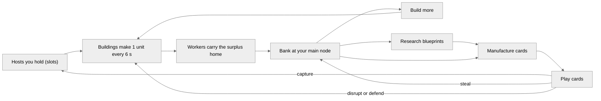
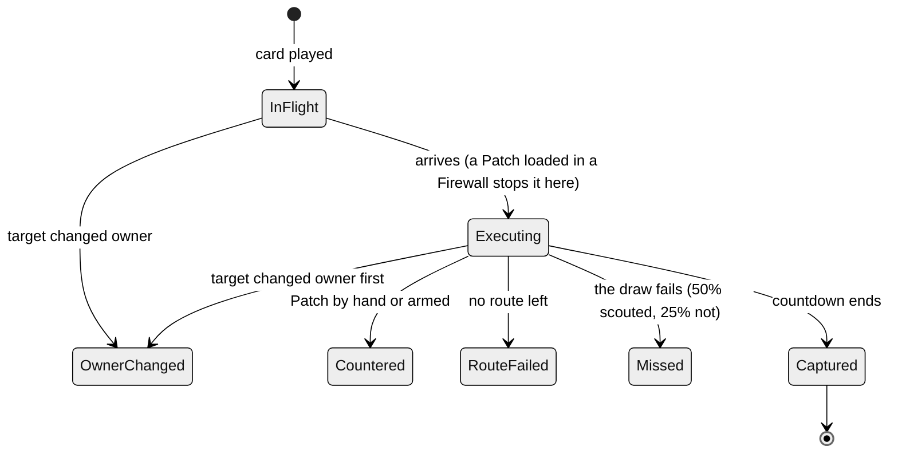

<!-- Generated by docs/tools/build_design.py from the game's config. Edit the tools, not this file. -->

# RIM design reference

The whole design of RIM as the game runs it: flow, map, economy, logistics, every card, defence, winning, the AI, multiplayer and the interface, with derived numbers for analysis. Same content as [design.html](design.html); every constant is in [rim_constants.json](rim_constants.json).

RIM 0.6.18 · commit 079d516

## Contents

- [Overview and core loop](#overview-and-core-loop)
- [Match flow](#match-flow)
- [Time model](#time-model)
- [Map and network](#map-and-network)
- [Host types](#host-types)
- [Sight and fog](#sight-and-fog)
- [Resources and banks](#resources-and-banks)
- [Production cycle](#production-cycle)
- [Logistics](#logistics)
- [Buildings](#buildings)
- [Research and manufacturing](#research-and-manufacturing)
- [How cards resolve](#how-cards-resolve)
- [Attack cards](#attack-cards)
- [Defence cards](#defence-cards)
- [Firewall](#firewall)
- [Counters](#counters)
- [Winning and elimination](#winning-and-elimination)
- [AI](#ai)
- [Multiplayer](#multiplayer)
- [Interface and controls](#interface-and-controls)
- [Simulation step](#simulation-step)
- [Derived numbers](#derived-numbers)
- [Price table](#price-table)
- [All constants](#all-constants)
- [Unused config](#unused-config)
- [For review](#for-review)


## Overview and core loop

RIM is a real-time strategy game about botnets on a generated city network. Two to four networks (you and 1–3 AI rivals, or 2–3 players online) start in different parts of the town. There are no units to fight with: everything is done with **cards**. You build an economy inside the hosts you own, research card blueprints, manufacture single-use cards, and play them on hosts. Capture cards take hosts, theft cards take resources, disruption cards stop production, defence cards protect. You win by holding 51% of all hosts for 51 s in a row, or by being the last network with a main node.



*The core loop. Every arrow out of a building passes through logistics: a resource can be spent only once it is home.*

- **Everything is delivered.** Output made away from the main node is worth nothing until a Bot carries it home along your own hosts.
- **Cards do all the fighting.** Captures have execution times and succeed unless stopped; theft and disruption have durations; defence answers them.
- **Timing and information.** Fog hides rival hosts; execution countdowns give the defender a window; a Firewall lets you decide the defence in advance.

## Match flow

#### Setup (Skirmish)

- Layout: not an option. The seed picks Spiral, Elliptical, Ring or Grid, so a seed always rebuilds the same layout and map.
- Size: Small 6×4 (≈20 hosts), Medium 8×6 (≈41 hosts), Big 10×8 (≈68 hosts).
- Enemies: 1–3 AI networks (NYX, KRAKEN, VIPER).
- Seed: a number for a repeatable town, blank for a random one.

#### Other modes

**Learn:** never required. One continuous session on a small grid town, five lessons in a row: capture, build and deliver, research and manufacture, theft and defence, then open play against an active rival. Nothing is rebuilt between lessons: what you built and earned stays, and a lesson brings in its new situation on top (a rival takes the gateway, a practice host appears). A finished step hands straight on; its result stays as one line above the next instruction. A lesson's first steps, whose action is available at once, pause the game until you act (or press Space); a step that follows something the rival did never pauses, names who did it and points at the host to act on. In open play the banner shrinks after 10 s to one line that keeps the goal in view. Continue restarts the saved lesson with what the earlier lessons had you do.

**Multiplayer:** hidden from the menus for now. The lockstep backend and its tests remain; see [Multiplayer](#multiplayer).

#### Start state (every network)

- A main node: a Server (3 slots) with an Intel harvester and a Bot station already built, one slot free.
- One empty PC next to it, already yours.
- Bank: 80 Intel, 40 Crypto, 30 Creds, 20 Research.
- Known recipes: Recon, Credential breach, Phishing, Patch, Incident response.
- Every other host is neutral: no buildings and no defence.

#### Ending

The match ends when one network holds the majority for 51 s or is the last with a main node. In single player, losing your main node loses the match; in multiplayer you are out and the others play on. Space pauses a single-player match; multiplayer never pauses.

| Phase     | Typical time | What happens                                                                                                                                                                                                                                                                                           |
|-----------|--------------|--------------------------------------------------------------------------------------------------------------------------------------------------------------------------------------------------------------------------------------------------------------------------------------------------------|
| Opening   | 0–1 min      | Fill the main node's free slot (a Miner, Credential harvester or Lab: each makes its resource with no input); lay out the PC (Bot station, Intel harvester, a second producer); make the first Breach (12 Intel, 12 Credentials: the start bank covers it) and take a first neutral host.              |
| Expansion | 1–6 min      | Scout and Breach neutral hosts: a Recon gets through half the time, and a scouted Breach that runs its 15 s takes its host half the time (a quarter unscouted). Credentials run short first, so Credential harvesters come next; research Known exploit (40 s) and build a Lab for its Research price. |
| Contact   | 5–10 min     | Borders meet. Theft (Phishing, Packet siphon, Vault raid), DDoS and Sabotage on rival hosts; Firewalls with loaded Patch, Response and Filter on key hosts; Known exploit (9 s) and Worm against rival hosts, where a defender may send a Patch.                                                       |
| End game  | 10 min +     | 0day (5 s, 12 s on a main node) against defended hosts and rival main nodes (elimination); the race to hold 51% of all hosts for 51 s.                                                                                                                                                                 |

Measured sample (0.6.4): four AIs on a Medium spiral (41 hosts), seeds 1–5, 10 minutes each, at 5 units a minute per producer. Held hosts grow from 8 to 14–17. Per match 18–23 intrusions resolve and 27–35 cards are played. All intrusions were Credential breaches on neutral hosts. 54 Recons: 35 got through, 19 missed. Scouted breaches: 21 captured, 18 missed. Unscouted: 16 captured, 49 missed. Overall 37 of 104 breaches captured (36%; the odds predict about 32% for this mix). After 10 minutes the largest network holds 4–5 of the 21 hosts needed. Each AI keeps building on credit, one project at a time, taking turns with its cards. It reaches 7–13 buildings, 4–6 workers and 2–3 blueprints by 10 minutes (0.6.3's AI stopped at 4 buildings and 2 workers). It scouts first and keeps the capture copy for the scouted host; when the Recon misses and no other is in hand or being made, it attacks at 25%.

## Time model

| Clock                       | Value                                 | Notes                                                                                                                                                                                                                                       |
|-----------------------------|---------------------------------------|---------------------------------------------------------------------------------------------------------------------------------------------------------------------------------------------------------------------------------------------|
| Simulation step             | 1/30 s                                | Fixed step; the screen draws at up to 60 fps (30 in menus or in the background) and never changes the rules.                                                                                                                                |
| Production cycle            | 6 s                                   | Per host, each on its own phase, so the network does not pulse all at once. Every producer makes 1 unit a cycle: 10 a minute (0.6.18: the flow doubled so workers are rarely free; every price, cap, store and theft haul doubled with it). |
| Main node trickle           | 1/6 per s each                        | Continuous: 1 of every resource per 6 s (10 a minute).                                                                                                                                                                                      |
| AI decisions                | every 2.5 s                           | Each AI on its own offset.                                                                                                                                                                                                                  |
| Travel                      | 1 s per link + 0.25 s per host passed | Halved by Express route; queues when a link is full.                                                                                                                                                                                        |
| Construction                | 10 s (+5 s to replace)                |                                                                                                                                                                                                                                             |
| Research                    | 30–70 s                               | One at a time.                                                                                                                                                                                                                              |
| Manufacturing               | 3–26 s per copy                       | One queue of four, one copy at a time.                                                                                                                                                                                                      |
| Execution (reaction window) | 5–15 s                                | Breach 15 (30 on a main node), Known exploit 9 (20), 0day 5 (12), Worm 9 (20) per stage, Vault raid 10.                                                                                                                                     |
| Effects                     | 30–180 s                              | Siphon 60, DDoS 45, Phishing 180, Sabotage 60; Filter and Cover 30, Express 45; Patch recovery 30; Recon view 45.                                                                                                                           |
| Win hold                    | 51 s                                  | Continuous.                                                                                                                                                                                                                                 |
| Multiplayer turn            | 0.1 s                                 | 3 steps per turn; commands run 2 turns (0.2 s) after they are sent.                                                                                                                                                                         |

## Map and network

#### Hosts and shapes

About cols × rows × 0.85 hosts (at least 12). Galaxies: a **spiral** with one arm per network and each main node at an arm's tip, a wide **elliptical** disc denser in the middle, or a **ring** with an empty middle; each host is the best of 10 random spots, never closer than 0.85 cells to another. The **grid** places one host per cell with 15% of cells left empty.

Networks start at even angles round the centre (you top-left). Each start is a main node plus one second host.

#### Value and type

Each host gets a value 1–3 from how far it is from every start (galaxy: the nearest third is 1, the middle 2, the farthest 3; grid: distance from the centre), with a 20% chance of ±1. Value picks the host type by the weights below, so the rich, well-defended hosts sit away from every start. A central **hub** (an ERP system) stands in the middle of every layout but the ring.

#### The hidden network

Every two hosts within 1.55 cells (≈295 px) are linked; islands are joined to the main town by their shortest gap. Links are never drawn; a link you have sent anything over becomes a faint **road** on your map for the rest of the match. Rivals' roads are never shown.

#### Junctions

The 2 best-connected mid-town hosts (value 2+, 3+ links, not a start) are junctions: their links carry 16 packets per second per direction instead of 8. Supply lines cross them, which makes them the natural place for a Packet siphon or a DDoS.

| Host value               | IoT device | PC  | Server | Web server | File server | Database | ERP system |
|--------------------------|------------|-----|--------|------------|-------------|----------|------------|
| 1 (near starts)          | 35%        | 40% | 10%    | 10%        | 5%          | ·        | ·          |
| 2                        | ·          | 30% | 20%    | 20%        | 15%         | 15%      | ·          |
| 3 (far from every start) | ·          | ·   | 20%    | 15%        | 20%         | 25%      | 20%        |
| hub                      | ·          | ·   | ·      | ·          | ·           | ·        | always     |

## Host types

| Type        | Slots | Multipliers (output and input)                           |
|-------------|-------|----------------------------------------------------------|
| IoT device  | 1     | Credentials ×0.5, Research ×0.5                          |
| PC          | 3     | none                                                     |
| Server      | 3     | Intel ×1.5, Research ×1.5                                |
| Web server  | 3     | Intel ×1.5, Credentials ×2                               |
| File server | 4     | Intel ×2, Research ×2                                    |
| Database    | 4     | Intel ×2, Credentials ×1.5, Research ×1.5                |
| ERP system  | 5     | Intel ×1.5, Crypto ×1.5, Credentials ×1.5, Research ×1.5 |

- There are no security levels: any capture card can target any host. A held main node takes longer to execute against (each card's main-node time).
- A multiplier scales what a building makes: a Credential harvester on a web server makes 2 Credentials per cycle; a Bot station has 2 workers on any host type.
- When a host changes owner its buildings, storage, Firewall cards and effects are wiped, and its ownership generation counts up: operations aimed at the old owner become void.

## Sight and fog

- You see your own hosts and every host linked to one of them. Rival packets, effects and their busy streets show only there.
- Every main node is visible as a landmark, but nothing around it.
- Hosts you saw before stay on the map as dim outlines, without owner or contents; fogged hosts cannot be clicked.
- Host type and slot count are public. What is inside a rival host (buildings, storage, Firewall cards) is shown only by a fresh Recon (45 s), which also raises your attacks on it from 25% to 50%. A Recon itself gets through half the time.
- Territories: each held, visible host claims a round patch; one network's patches merge, and the ground between rivals is split halfway.

## Resources and banks

| Resource    | Comes from                                                                 | Is spent on                                                                                                                                                                 |
|-------------|----------------------------------------------------------------------------|-----------------------------------------------------------------------------------------------------------------------------------------------------------------------------|
| Workers     | 2 per finished Bot station (the main node starts with one); not a resource | Nothing: workers carry. Each carries 1 unit a leg (an export's last unit takes the fraction left beside it) and returns for another job. No card or building costs workers. |
| Intel       | Intel harvesters (1 per cycle), the trickle                                | Most cards, the harvesters and Miners, part of other buildings and blueprints, Firewall upkeep.                                                                             |
| Crypto      | Crypto miners, the trickle                                                 | Most of the Bot station, Lab and Firewall, most blueprints, some cards.                                                                                                     |
| Credentials | Credential harvesters, the trickle                                         | Breach (its focus), Phishing, Packet siphon, Vault raid, 0day, Sabotage, Incident response.                                                                                 |
| Research    | Research labs, the trickle                                                 | Research projects, Known exploit and Worm (their focus), 0day and most advanced cards.                                                                                      |

``` code
bank cap(resource) = BASE_CAP[resource] + 50 × (your buildings whose output is that resource)
BASE_CAP = Intel 300, Crypto 600, Credentials 300, Research 300
spendable   = what is in the bank at your main node (nothing else counts)
income      = main-node trickle (1 of each per 6 s, while the main node is held and not under DDoS)
            + building output that reaches the bank
```

Anything that would go over a cap is lost: the trickle and main-node production clamp at the cap, and workers are not sent to a full bank (shipments on the road reserve their room, and so do supplies on their way to a host's storage or a project's escrow).

### Accounting: what the rates mean

Every change to a bank is recorded once, with its cause, in one-second buckets over the last 30 s of play. These measured rates are shown as **historical** (the Economy overview and the HUD tooltips). The HUD itself shows a **forecast** (below).

| Kind     | Causes                                                                                                                                                                                                                             |
|----------|------------------------------------------------------------------------------------------------------------------------------------------------------------------------------------------------------------------------------------|
| Received | trickle (the main node), production (buildings on the main node), delivered (cargo from your hosts), stolen (Phishing, Siphon and Vault-raid loot), returned (a Phishing that ended), refunds (a cancelled build, copy or project) |
| Spent    | buildings (materials a project takes from the bank), manufacturing, research, supply (a unit a worker takes out to one of your hosts: a Firewall's upkeep), upkeep (a main-node Firewall)                                          |
| Lost     | cap (income that arrived at a full bank), cargo (lost with a host it waited in), site (a project's materials lost with its host), stolen (escrow taken by a Vault raid), siphoned (cargo grabbed by a rival's Packet siphon)       |

``` code
net rate(resource) = (received − spent) over the window × 60 / window seconds
on the road        = shipments in flight to the bank, the next arrival, and how many no longer have a route home
```

Within the window the recorded flows reconcile exactly with the bank. The ledger is presentation only: it is not part of the multiplayer fingerprint.

### The income forecast

Under each material the HUD shows what will reach your bank per minute with your network as it stands: worked out from the network, not from the ledger, so it is steady while nothing changes and moves as soon as something does (a command, a capture, a full bank, a host's storage filling with output). A full bank reads “full”.

``` code
forecast(res) = main-node trickle (10/min while the main node is up)
              + main-node buildings' output
              + Σ over hosts whose output is yours: what one cycle there sends home × 10/min, where
                  inputs  = only a Firewall's upkeep (1 Intel): this cycle's harvest on the host first
                            (it needs no storage room), then what is stored there, or brought by workers
                  trips   = the workers' trips a minute, dealt as the dispatcher deals them: supplies and
                            Firewall upkeep strictly first, then the hosts' trips even out (deliveries to
                            construction are left out). A trip carries one unit; a supply goes out and the
                            host's output comes back on the same round trip. Intel a host gives a neighbouring
                            Firewall rides that host's own trips (0.6.18: shared by every host that may give it,
                            in proportion to the Intel each one's trips move), and the worker who brings it
                            carries the Firewall host's output home: one leg, not a round trip. Short of
                            workers, they make as many trips as their time allows
                  sent    = what those trips carry; a host they cannot keep up with stays full, so it makes
                            only what leaves, every producer the same share
                  a Firewall's upkeep on a host you phish comes out of your Intel once the owner keeps none there
                  nothing from a host with no route home, under DDoS, whose storage is full of someone else's
                  stock, while your main node is under DDoS (no worker leaves), or into a full bank
```

The tooltip and the Economy overview name where it comes from and what holds it back, and how much is stored at hosts, in transit and reserved at the main node. The Workers column shows the population and what it is doing (busy · free · blocked), not an income.

## Production cycle

``` code
every 6 s, for each held host h (on its own phase):
  beneficiary = the Phishing thief while h is phished, else its owner
  storage     = the beneficiary's bank if h is their main node, else h's storage (20 units, all resources together)

  share = min(1, free storage / this cycle's whole output)      (1 at the main node: the bank)
  1. Producers, no input (0.6.12): + 1 × m × share of their own resource each
        (Intel harvester → Intel · Crypto miner → Crypto · Credential harvester → Credentials · Research lab → Research)
  2. Firewalls:         each eats 1 Intel from storage (the owner's first); paid in full → on, else off
  (Bot stations make nothing: each provides 2 reusable workers for its host)

a storage that cannot hold the whole cycle gives every producer the same share: none crowds another out

active = built, not under construction, not under DDoS, not sabotaged (a building cannot be paused)
m      = the host type's multiplier for that resource
```

| Layout (on a PC, ×1)                                      | Made each cycle                                                | Delivered each cycle                     | Net to the bank per minute                   |
|-----------------------------------------------------------|----------------------------------------------------------------|------------------------------------------|----------------------------------------------|
| Bot station + Intel harvester + Miner                     | 1 Intel + 1 Crypto; 2 workers for the pool                     | 2 units by your workers                  | +5 Intel, +5 Crypto                          |
| Bot station + Intel harvester + Cred. harvester           | 1 Intel + 1 Credential; 2 workers                              | 2 units by your workers                  | +5 Intel, +5 Creds                           |
| Intel harvester + Miner + Lab                             | 1 Intel + 1 Crypto + 1 Research                                | 3 units by your workers                  | +5 Intel, +5 Crypto, +5 Research             |
| 2 Intel harvesters + Miner                                | 2 Intel + 1 Crypto                                             | 3 units by your workers                  | +10 Intel, +5 Crypto                         |
| Bot station alone (IoT device)                            | 2 workers for the pool                                         | nothing to carry                         | 0                                            |
| Miner alone                                               | 1 Crypto, no input                                             | 1 unit by your workers                   | +5 Crypto                                    |
| Database: harvester + 2 Cred. harvesters                  | 2 Intel + 3 Credentials (Database: Intel x2, Credentials x1.5) | 5 units by your workers                  | +10 Intel, +15 Creds                         |
| Main node (Server): Intel harvester + Bot station + Miner | 1.5 Intel + 1 Crypto; 2 workers                                | straight into the bank, plus the trickle | +13 Intel, +10 Crypto, +5 Creds, +5 Research |
| \+ a Firewall on the host                                 | uses 1 Intel                                                   | —                                        | −5 Intel                                     |

### Host status

Your host's panel is only a build menu, with no prose. Its diagnosis is in the tooltip of each of its slots, which lists the host's first two problems in this order. The diagnosis is worked out exactly as the next cycle will run, so it never promises output the host cannot make.

| Status              | When                                                                                          | What the tooltip suggests                                                                              |
|---------------------|-----------------------------------------------------------------------------------------------|--------------------------------------------------------------------------------------------------------|
| under DDoS          | a DDoS is active here                                                                         | nothing is made or sent until it ends                                                                  |
| sabotaged           | a Sabotage is active here                                                                     | producers are off; cargo still passes                                                                  |
| phished             | a rival's Phishing is active here                                                             | output goes to them until it ends (Incident response clears it)                                        |
| no route            | no chain of your hosts links it to your main node                                             | retake a host between them                                                                             |
| starved             | a Firewall lacks its Intel here and none can come                                             | build an Intel harvester here, or a Bot station                                                        |
| blocked             | storage full, or the bank for what is stored (or a main-node producer's output) is at its cap | spend that resource; storage that is full of surplus ships as workers come free                        |
| waiting for workers | units are stored and every one of your workers is busy (or you have none)                     | wait, or build a Bot station on any of your hosts: all workers are one pool working from the main node |
| Firewall off        | the next cycle cannot pay the Firewall's Intel                                                | build an Intel harvester here                                                                          |
| building · idle     | nothing finished yet · nothing installed                                                      | —                                                                                                      |
| operating           | none of the above                                                                             | —                                                                                                      |

## Logistics

#### Workers

Each finished Bot station provides two reusable workers that belong to its host; the main node starts with its station's two. A worker carries 1 unit per leg; delivery does not consume it. States: available (free, wherever it is), collecting, carrying, blocked, heading home. A worker lost on a cut route is replaced after 5 s if its station still stands; a demolished or replaced station's workers retire after their leg; capture destroys every worker of the captured host's stations, even those away. The map shows a loaded worker as a filled dot in its cargo's colour, an empty one as a ring, each direction on its own side.

#### Who carries, and what first

Installations use what is on their host first. A host asks for its Firewalls' upkeep and its construction bills; producers need no input. Whatever its next cycle does not need is surplus. **Workers go where they are needed, from wherever they are** (0.6.16): a job moves one unit from a source to a destination, and a worker is free where it delivers and takes its next job from there; with nothing to do it heads home. **Building comes strictly first:** every free worker serves construction and upkeep while any of it can go — a Firewall's upkeep first, then Bot stations, then projects in the order given — and their materials come from the nearest place that can spare them (your bank, a host's spare stock, your own salvage) **straight to the site**, never through the main node. What the main node's own projects lack is brought home from the hosts first. Then the surplus goes home: the surplus where a free worker already stands first, so it carries it on instead of walking empty to another host (0.6.18), then the hosts about to fill up (counting what workers are already on their way to collect), the hosts in turn, the resources of one host in turn; stolen goods last. A worker that leaves a host for the main node to fetch supplies takes a unit of that host's surplus along (0.6.18). A host's surplus waits for a worker already on its way there, loaded or still going to its pickup, rather than drawing a second one. A Firewall host that makes no Intel keeps up to three cycles of it: two asked from anywhere, the third only from a neighbour's surplus, which goes to it instead of home when it is no farther. A collection claims its unit and the destination holds room for what is coming, so two workers never take the same unit. Nothing is sent to a full bank or a full storage.

#### No supply settings

Supply is automatic and in the background: there is nothing to set per host. What a host's next cycle needs is brought; what was brought for it is not carried back out.

#### Construction

Ordering is free. A project's materials go into an escrow at its site — separate from the 20-unit storage, so a 32-unit Bot station fits any host — first from what the host has spare, the rest carried by workers one unit a leg. Its 10 s of work run only once the whole bill is there. A project cannot be paused, only cancelled: cancel leaves what was delivered (less what the work used) at the site as salvage for workers to take home; capture destroys it; a Vault raid can steal unconsumed escrow and the shortage reopens.

#### Routes

Workers and every card travel only through your own hosts and never through one under DDoS (shortest path by links). Neutral and rival hosts are never relays; a rival host can only be the end of an attack. The way is checked again every time a packet leaves a host.

#### Speed and capacity

``` code
travel = links × 1 s + hosts passed × 0.25 s   (× 0.5 with Express route)
each link direction admits 8 packets per second (16 on a junction's links); extra packets wait
```

#### Held and lost

When the way on is cut (a relay taken or under DDoS) a packet waits at the last host it reached, marked **held**, and goes on as soon as a route opens. A worker whose destination is lost turns back with its cargo. A card held for 20 s, or whose target is gone, comes back to your hand. Packets are lost only with a host they wait in; a worker that collected on a rival's host (theft) waits there for its way home. A rival's Express or Cargo cover on its own host never helps your workers leaving it. Packet siphon drops grabbed cargo on its host for the thief's workers; Cargo cover protects it.

**Interpretations (0.6.2):** a worker lost on a cut route is replaced after 5 s while its station stands; a station whose host has no route to the main node keeps its new workers waiting there; cancelling a project during its work leaves the unworked share of its materials at the site; one in four assignments is a host turn. Cargo and workers are never teleported.

## Buildings

| Building             | Each cycle         | Build price         | Bank cap          | Rules                                                                                                                                                                                                                                                                           |
|----------------------|--------------------|---------------------|-------------------|---------------------------------------------------------------------------------------------------------------------------------------------------------------------------------------------------------------------------------------------------------------------------------|
| Intel harvester      | +1 Intel           | 24 Intel            | +100 Intel cap    | No input. Its Intel is stored on the host until workers take it home (a Firewall there eats 1 a cycle).                                                                                                                                                                         |
| Bot station          | 2 reusable workers | 8 Intel, 24 Crypto  | —                 | Provides 2 reusable workers that join the one pool working from the main node. Each carries 1 unit per leg: building materials and a Firewall's upkeep out, output back. A worker lost on the road is replaced after 5 s; capture of its host destroys them, wherever they are. |
| Crypto miner         | +1 Crypto          | 30 Intel            | +100 Crypto cap   | No input (since 0.6.12): it makes Crypto on its own, like a harvester.                                                                                                                                                                                                          |
| Credential harvester | +1 Creds           | 30 Intel, 8 Crypto  | +100 Creds cap    | No input (since 0.6.12): it makes Credentials on its own.                                                                                                                                                                                                                       |
| Research lab         | +1 Research        | 24 Intel, 32 Crypto | +100 Research cap | No input (since 0.6.12): it makes Research on its own.                                                                                                                                                                                                                          |
| Firewall             | −1 Intel upkeep    | 20 Intel, 60 Crypto | —                 | Not a producer. 3 sockets for defence cards per Firewall. Eats 1 Intel from its own host each cycle (workers bring it when none is made there); without it the Firewall is off and its cards wait. It does not make the host harder to capture.                                 |

- Click a slot in the host panel and pick a building from the list (each with what it makes or uses and its price, as icons). Ordering is free; workers bring its materials, then the job takes 10 s. Picking a building for an occupied slot replaces it: the old one is demolished first (5 s).
- A building cannot be paused: it works whenever it can. A project can be cancelled (the red button); right-click demolishes.
- Every building of a resource's kind adds 50 to that resource's bank cap (the Firewall adds nothing).

## Research and manufacturing

#### Research (RESEARCH tab)

The tab shows the tree: every recipe under the one it is researched from, marked known, researching, open or locked. One blueprint at a time. Its price is paid bit by bit over its research time and it waits whenever a resource runs short. It never takes what your projects still need (building first) or the price of the card at the head of the queue while that card could start; the bar says what is missing and what is kept, and for whom. While it still pays now and then it reads **slowed** (a resource comes in slower than it uses); only after a whole production cycle without a payment does it read **stopped** and raise a Logs entry. Click it again to pause; cancelling stops the payments (what was paid is spent). Research unlocks the recipe; it gives no card.

#### Manufacturing (ATTACK and DEFENCE tabs)

These tabs hold only the recipes you know. **+ Queue** adds a copy to one first-in-first-out queue of at most four, the copy being made included. Only the head is made: its whole price is paid when it starts, from main-node stock no worker has claimed, then it takes its make time. A head that cannot start says what it lacks and nothing overtakes it; while the queue runs and the Ready inventory has room, its price is kept for it from research and from supplies. Removing a waiting copy is free; cancelling the one being made refunds its unworked share. The queue pauses on its own button. Ready copies plus the copy being made plus cards in flight: at most 12. Copies never expire. A persistent research bar under the top bar shows the active blueprint, its progress and whether it is active, paused or stalled.

| Blueprint             | Needs             | Price and time                          | Early · mid wait |
|-----------------------|-------------------|-----------------------------------------|------------------|
| Known exploit         | Credential breach | 16 Intel, 40 Crypto, 40 Research, 40 s  | 240 s · 120 s    |
| 0day                  | Known exploit     | 32 Intel, 88 Crypto, 100 Research, 70 s | 600 s · 300 s    |
| Worm                  | Known exploit     | 24 Intel, 64 Crypto, 72 Research, 55 s  | 432 s · 216 s    |
| DDoS                  | Recon             | 16 Intel, 40 Crypto, 36 Research, 35 s  | 216 s · 108 s    |
| Supply-chain sabotage | DDoS              | 28 Intel, 76 Crypto, 88 Research, 60 s  | 528 s · 264 s    |
| Packet siphon         | Phishing          | 16 Intel, 40 Crypto, 40 Research, 40 s  | 240 s · 120 s    |
| Vault raid            | Packet siphon     | 24 Intel, 64 Crypto, 80 Research, 55 s  | 480 s · 240 s    |
| Traffic filter        | Patch             | 12 Intel, 32 Crypto, 28 Research, 30 s  | 168 s · 84 s     |
| Cargo cover           | Patch             | 12 Intel, 32 Crypto, 28 Research, 30 s  | 168 s · 84 s     |
| Express route         | Recon             | 16 Intel, 40 Crypto, 40 Research, 35 s  | 240 s · 120 s    |

## How cards resolve

#### Playing an attack card

- Target: a foreign host (neutral or a rival's).
- Reachable: you hold a host linked to the target and a path of your hosts from your main node to it (or the target is linked to your main node).
- Your main node must not be under DDoS.
- One capture or raid per attacker per host at a time.
- No security levels: any card may target any foreign host.

#### Flight and arrival

The card flies from your main node along that path. It always arrives (the route is checked again when it resolves), unless the target changed owner on the way: then it is void. Effects (Recon, Phishing, Siphon, DDoS, Sabotage) apply on arrival. **Intrusions** (captures, Worm stages, Vault raid) start an execution countdown that the owner sees on the host.

#### When an execution ends

Intrusions resolve earliest end first, equal end times in launch order. Each ends in exactly one outcome, with its own message: an armed Patch stops it (**countered**); a target that changed owner first voids it (**owner changed**; a host can never be captured twice from the same generation); no path left fails it (**route failed**). Only then the odds: one draw from the match's seeded dice decides it, at 50% with fresh Recon of the host (yours, still fresh at this moment) and 25% without (**missed** on a fail). Otherwise it is **captured** (a Vault raid **raids**). Commands accepted for a step (a manual Patch included) apply before that step's intrusions resolve.

#### The Recon rule

A Recon gets through 50% of the time (RECON_CHANCE), whatever the host; a miss shows nothing, and only its sender hears of it. Every other attack card succeeds 50% against a host you hold fresh Recon of (SCOUTED_CHANCE) and 25% without (UNSCOUTED_CHANCE): one draw per operation. Effects that land on arrival (Phishing, Siphon, DDoS, Sabotage) draw on arrival, after a loaded Response has had its say; a DDoS or Sabotage reaching several hosts is one operation with one draw; each Worm stage is its own operation. Counters, a void target or a lost route are always decided first: a draw never lets a card past them. The draw comes from a generator seeded by the map, the same on every screen, and part of the multiplayer fingerprint. Defence cards on your own hosts always work.

#### Defence cards

Played on one of your own hosts. They leave your main node and travel through your hosts like any packet, and act only on arrival (one played on the main node acts at once); a host with no route from your main node cannot receive one. Patch, Incident response, Traffic filter and Cargo cover load into a free Firewall socket on arrival instead, unless their attack is already there. A card that will load holds its socket while it travels, so two deliveries never claim the same socket.



*The life of a capture card.*

## Attack cards

“≈ early · mid” is the price in seconds of income on the resource that runs out first, for the two reference networks in [Derived numbers](#derived).

### Recon

`ATTACK` `Known from the start`

Scout a host: better odds for 45 s.

**Make:** 16 Intel, 3 s (≈ 27 s early · 13 s mid of Intel income)

- **Why it exists:** Tells you whether an expensive card will pay off: what a host holds, how full its storage is, and whether a Patch waits in its Firewall.
- **Play it when:** Before an 0day, Vault raid, Worm or Sabotage, or to find a rival's richest host.
- **Target:** Any foreign host your operations can reach.
- **Timing:** Travels, then takes effect on arrival. No execution.
- **Effect:** Takes a snapshot of the host: what is in each slot, how full its storage is, and which cards wait in its Firewall. You see the snapshot, not later changes, for 45 s; then the slots go back to “?”.
- **Quiet:** The target gets no red frame and no pulse. It is the only attack card that does not show.
- **Its own odds:** A Recon gets through 50% of the time (RECON_CHANCE), whatever the host. A miss shows nothing, and only you hear of it.
- **Odds:** While the snapshot is fresh (45 s, and only for the faction that made it), your other attack cards on that host succeed 50% of the time (SCOUTED_CHANCE); without it, 25% (UNSCOUTED_CHANCE). Freshness is judged when the operation resolves. A change of owner voids it. Defence cards on your own hosts always work.

### Credential breach

`ATTACK` `Known from the start`

Capture a host in 15 s.

**Make:** 24 Intel, 24 Creds, 12 s (≈ 144 s early · 48 s mid of Credentials income)

- **Why it exists:** The way to grow: every host adds slots, and holding 51% of all hosts wins.
- **Play it when:** On neutral hosts first, as nobody defends them; scouted, for 50% instead of 25%.
- **Target:** Any foreign host your operations can reach, neutral or a rival’s. There are no security levels.
- **Timing:** Travels, then executes for 15 s on the host (30 s on a held main node). The owner sees “Breach executing” and has that long to react.
- **Outcome:** When its execution ends: first a Patch (**countered**), losing your path to it (**route failed**) or another owner taking it first (**owner changed**) stop it; then one draw (**missed** on a fail): 50% with fresh Recon of the host, 25% without.
- **Effect:** On success the host becomes yours. All of its buildings, storage, Firewall cards and running effects are wiped: you start with empty slots.
- **Stopped by:** A Patch (by hand during execution, armed in advance, or loaded in a Firewall: then it never starts), losing your path to a neighbour of the host, or the host changing owner meanwhile.
- **Limit:** One capture or raid per attacker per host at a time.

### Known exploit

`ATTACK` `Research after Credential breach`

Capture a host in 9 s.

**Make:** 28 Intel, 24 Research, 14 s (≈ 144 s early · 72 s mid of Research income)

- **Why it exists:** A faster capture: 9 s leaves a defender little time to get a Patch there.
- **Play it when:** Against a rival's hosts, where a Patch might be sent.
- **Target:** Any foreign host your operations can reach.
- **Timing:** Travels, then executes for 9 s (20 s on a held main node): less time for a defender's Patch to travel there.
- **Outcome:** As Credential breach: countered, route-failed, owner-changed, missed (the draw failed) or captured.
- **Effect:** As Credential breach: the host becomes yours, wiped.
- **Stopped by:** As Credential breach.

### 0day

`ATTACK` `Research after Known exploit`

Capture a host in 5 s.

**Make:** 32 Intel, 24 Crypto, 24 Creds, 32 Research, 26 s (≈ 192 s early · 96 s mid of Research income)

- **Why it exists:** The fastest capture: 5 s (12 s on a main node) leaves only an armed or loaded Patch in time: the card for a defended host or a rival main node.
- **Play it when:** After a Recon shows no Patch waiting, or after a cheaper card has used it up.
- **Target:** Any foreign host your operations can reach.
- **Timing:** Travels, then executes for 5 s; 12 s on an active rival main node, with a countdown the owner sees. Usually only a Patch already armed or loaded in a Firewall is in time.
- **Outcome:** As Credential breach: countered, route-failed, owner-changed, missed (the draw failed) or captured.
- **Effect:** The host becomes yours, wiped. On a rival main node the rival is eliminated: their banks and cards are cleared, their flights and workers vanish, and every other host they held becomes **yours with its finished buildings** (storage, sockets, projects and effects cleared; its Bot stations staff themselves for you at once). You keep the old main node as an ordinary host.
- **Stopped by:** As Credential breach.

### Worm

`ATTACK` `Research after Known exploit`

Capture 2 linked hosts in turn.

**Make:** 36 Intel, 36 Research, 22 s (≈ 216 s early · 108 s mid of Research income)

- **Why it exists:** Two captures in one launch, reaching a host behind a rival's front line.
- **Play it when:** When a rival holds a chain of linked hosts; scout both.
- **Target:** Any foreign host your operations can reach.
- **What it is:** A capture on up to 2 linked hosts, one after the other.
- **Timing:** Travels; each stage executes for 9 s (20 s on a main node), and each can be stopped on its own.
- **Chain:** Once the first host is captured, the second stage starts on the nearest (by map distance, then host number) visible host linked to it that belongs to the **same owner** as the first target. It never jumps to another owner. Each stage is its own operation with its own draw (50% scouted, 25% not); if the first host had fresh Recon, the second counts as scouted too. Both stages land 25% of the time with the first host scouted, 6.25% without.
- **Stops when:** A stage is countered by a Patch, its route is lost, its host changes owner, or no such neighbour exists. A stopped stage ends the chain; a stage already captured stays captured.

### Phishing

`ATTACK` `Known from the start`

Divert new output for 180 s.

**Make:** 36 Intel, 12 Crypto, 16 Creds, 8 Research, 12 s (≈ 96 s early · 32 s mid of Credentials income)

- **Why it exists:** Hurts a rival without taking ground: you gain exactly what they lose.
- **Play it when:** On their best-producing host.
- **Target:** A foreign host (a rival’s; a neutral host makes nothing).
- **Timing:** Takes effect on arrival, for 180 s.
- **Effect:** What the host makes is kept there for you: your workers collect it and carry it to **your** main node. The host and its workers stay the owner's.
- **Victim:** Keeps the host but gets nothing from it. Its main-node trickle (if you phish a main node) still goes to them.
- **Ends:** After its time, or when Incident response clears it. Your unsent stolen units on the host then go back to the owner.

### Packet siphon

`ATTACK` `Research after Phishing`

Hijack cargo crossing a host.

**Make:** 40 Intel, 12 Crypto, 12 Creds, 10 Research, 12 s (≈ 72 s early · 32 s mid of Credentials income)

- **Why it exists:** Takes a whole supply line, not one host's output.
- **Play it when:** On a host their deliveries cross, set to the resource they need most.
- **In one line:** A tap on one of their hosts: for a while, their deliveries that go through it come to you instead.
- **Target:** A rival host their deliveries leave from or pass through (a junction is best). You pick the resource (Intel, Crypto, Credentials or Research) in the host’s Launch panel; a card dragged onto the map takes Crypto.
- **Timing:** Takes effect on arrival, for 60 s.
- **Effect:** Every unit of that resource carried by their workers leaving or passing the host after the siphon lands is dropped there for your workers to collect, up to 60 units. Their workers are not consumed.
- **Not affected:** Covered cargo (Cargo cover), empty workers, your own cargo.
- **Ends:** After its time, after its last unit, or when Incident response clears it.

### Vault raid

`ATTACK` `Research after Packet siphon`

Empty the storage of 3 linked hosts.

**Make:** 48 Intel, 20 Creds, 16 Research, 16 s (≈ 120 s early · 48 s mid of Credentials income)

- **Why it exists:** Punishes a network whose output piles up in storage.
- **Play it when:** On hosts with no Bot station, busy workers or no route home.
- **Target:** Any rival host.
- **Timing:** Travels, then executes for 10 s.
- **Effect:** Takes what is stored on the target and on its 2 nearest linked hosts of the same owner, up to 60 units, all resources, unconsumed construction materials included (the project's shortage reopens). The loot waits there; your main node's workers collect it, one unit a leg.
- **Best on:** Hosts whose output piles up: no Bot station, busy workers, or no route home.
- **Stopped by:** A Patch on the target, or your operation having no way home.

### DDoS

`ATTACK` `Research after Recon`

Halt 3 hosts' output for 45 s.

**Make:** 68 Intel, 28 Crypto, 10 Research, 14 s (≈ 113 s early · 54 s mid of Intel income)

- **Why it exists:** The only card that hits logistics: it strands supply lines and, on a main node, stops their attacks.
- **Play it when:** Right before your own big attack, or on the hosts their supply lines share.
- **Target:** Any foreign host.
- **Timing:** Takes effect on arrival, for 45 s.
- **Reach:** The target and its owner’s 2 hosts nearest to it on the map, all at once.
- **Effect:** Each one makes nothing, sends nothing and forwards nothing. New routes go round them. Workers whose route runs through one wait there until it is up. Cargo addressed to them still arrives.
- **On a main node:** Its one-of-each trickle and its producers stop, and its owner can play no card at all until it ends — no attack, and no defence card on any host, the main node included. Only cards already armed or loaded in a Firewall still act, so a DDoS on a main node opens a window for a capture.
- **Blocked by:** Traffic filter, host by host: a host under Filter ignores it; a Filter loaded in its Firewall fires and the DDoS never lands there.

### Supply-chain sabotage

`ATTACK` `Research after DDoS`

Shut producers on 3 hosts for 60 s.

**Make:** 72 Intel, 24 Crypto, 16 Creds, 28 Research, 22 s (≈ 168 s early · 84 s mid of Research income)

- **Why it exists:** Shuts a district's production for a minute without touching its logistics.
- **Play it when:** On their production cluster before a long fight.
- **Target:** A rival host.
- **Timing:** Takes effect on arrival, for 60 s.
- **Effect:** Switches off every producer on the target and on up to 2 more hosts of the same owner, each the nearest neighbour of the last, and keeps the workers of their Bot stations from setting out (a leg already under way finishes). Routing and Firewalls keep working; a main node keeps its trickle.
- **Cleared by:** Incident response, host by host (a Response loaded in a hit host’s Firewall clears that host at once).

## Defence cards

### Patch

`DEFENCE` `Known from the start` `Firewall socket`

Stop a capture or a raid.

**Make:** 24 Intel, 8 Crypto, 6 Research, 8 s (≈ 40 s early · 19 s mid of Intel income)

- **Why it exists:** Every capture has a countdown; Patch is the answer to it.
- **Play it when:** On a host under intrusion, or loaded at your main node.
- **Target:** One of your hosts.
- **By hand:** Cancels the capture, Worm stage or Vault raid running there that ends first. With nothing running, it arms the host for 30 s: the next one that would finish there in that time is blocked instead.
- **Loaded:** In a free Firewall socket it waits with no time limit and stops the next capture, Worm stage or Vault raid the moment it starts executing there.
- **Recovery:** Once a Patch stops something, the host recovers for 30 s: no other Patch can be played there, one on its way goes back to your hand, and the window is shown to everyone who sees the host. A Patch already loaded in its Firewall still fires, and restarts the window.

### Incident response

`DEFENCE` `Known from the start` `Firewall socket`

Clear theft and sabotage here.

**Make:** 24 Intel, 6 Crypto, 6 Creds, 4 Research, 6 s (≈ 40 s early · 19 s mid of Intel income)

- **Why it exists:** Theft and sabotage last a minute; this ends them.
- **Play it when:** On a host being phished, siphoned or sabotaged, or loaded where theft is likely.
- **Target:** One of your hosts.
- **By hand:** Ends Phishing, Packet siphon and sabotage on that host at once. Stolen units not yet sent come back to you. It does not clear DDoS, and with nothing to clear it does nothing.
- **Loaded:** Fires the moment Phishing, a siphon or sabotage lands on that host, so nothing is stolen or switched off.

### Traffic filter

`DEFENCE` `Research after Patch` `Firewall socket`

Clear DDoS and block it for 30 s.

**Make:** 28 Intel, 8 Crypto, 4 Research, 8 s (≈ 47 s early · 22 s mid of Intel income)

- **Why it exists:** DDoS is the strongest disruption and needs its own answer.
- **Play it when:** Loaded on a junction or on your main node.
- **Target:** One of your hosts.
- **By hand:** Clears a DDoS there and makes the host ignore DDoS for 30 s — unless your main node is under DDoS: then no card can be played at all.
- **Loaded:** Fires when a DDoS lands: the DDoS never takes effect and the host is immune for the same 30 s.

### Cargo cover

`DEFENCE` `Research after Patch` `Firewall socket`

Shield this host's cargo for 30 s.

**Make:** 24 Intel, 8 Crypto, 4 Research, 8 s (≈ 40 s early · 19 s mid of Intel income)

- **Why it exists:** Protects a supply line from the sending side.
- **Play it when:** On hosts whose workers cross a siphoned host.
- **Target:** One of your hosts.
- **By hand:** For 30 s the cargo of every worker that host sends (and those already on the road from it) cannot be siphoned anywhere on its way.
- **Loaded:** Fires when a siphon grabs this host’s cargo: that cargo is saved, and cover starts for 30 s.

### Express route

`DEFENCE` `Research after Recon`

Halve delivery time for 45 s.

**Make:** 28 Intel, 8 Crypto, 4 Research, 10 s (≈ 47 s early · 22 s mid of Intel income)

- **Why it exists:** A shorter road: deliveries arrive sooner and spend less time in reach of siphons and cuts.
- **Play it when:** On far producers, or while a siphon threatens your lines.
- **Target:** One of your hosts.
- **Effect:** For 45 s, workers leaving that host cross each link in half the time (0.5 s instead of 1 s, forwarding 0.125 s instead of 0.25 s).
- **Not loadable:** It cannot go in a Firewall socket.

## Firewall

#### What it is for

It does not make a host harder to capture. It holds defence cards that fire on their own when an enemy card hits the host, so a host is defended while you look elsewhere and faster than anyone can react by hand.

#### Loading

Each finished Firewall gives its host 3 sockets (a host may hold several Firewalls). A Patch, Incident response, Traffic filter or Cargo cover that arrives at a host with a free socket is loaded, unless the attack it answers is already there: then it acts at once. Its socket is held from launch, so the sockets are never overbooked; if the Firewall is gone when it arrives it acts instead. Express route cannot be loaded.

#### Power

Each Firewall eats 1 Intel from its own host every cycle (workers bring it when the host makes none). Without it the Firewall is off and its cards wait. Sockets are positions: the leftmost finished Firewall holds the first 3, the next one the next 3, and a card loads into the first empty position from the left. A card that fires leaves its position empty; demolishing or replacing a Firewall loses the cards in its own 3 positions as soon as the work starts, and a new Firewall gets 3 empty ones, so no card ever moves to another Firewall. Capturing the host wipes them. A rival's Recon shows what is loaded.

| Loaded card       | Fires when                                                       | Result                                                       |
|-------------------|------------------------------------------------------------------|--------------------------------------------------------------|
| Patch             | a capture, Worm stage or Vault raid starts executing on the host | it is stopped before its countdown begins                    |
| Incident response | Phishing, Packet siphon or sabotage lands on the host            | it ends at once; nothing is stolen or switched off           |
| Traffic filter    | a DDoS lands on the host                                         | the DDoS never takes effect; immune to DDoS for 30 s         |
| Cargo cover       | a siphon grabs this host's cargo                                 | that cargo is saved; the host's workers are covered for 30 s |

## Counters

| Attack                        | By hand                                                   | Loaded in a Firewall         | Other answers                                   |
|-------------------------------|-----------------------------------------------------------|------------------------------|-------------------------------------------------|
| Breach · Known exploit · 0day | Patch during execution                                    | Patch: stopped as it starts  | cut the attacker's route; take the host first   |
| Worm                          | Patch on the host it is executing on                      | Patch on either chain host   | cut its route                                   |
| Vault raid                    | Patch on the target                                       | Patch on the target          | keep storage empty (Bot stations, free workers) |
| Phishing                      | Incident response                                         | Response: ends it on landing |                                                 |
| Packet siphon                 | Response on the siphoned host; Cover on the sending hosts | Response or Cover            | Express route; route around it                  |
| DDoS                          | Traffic filter, host by host                              | Filter: never lands          |                                                 |
| Sabotage                      | Incident response, host by host                           | Response per host            |                                                 |
| Recon                         | —                                                         | —                            | none; it is silent                              |

## Winning and elimination

``` code
majority = ceil(0.51 × all hosts)
a network that holds ≥ majority hosts for 51 s in a row wins (the timer resets the moment it drops below)
a network with no hosts left is out; the last network with hosts wins
the HUD, standings, Help and the result all read one function (_objective) for these numbers
losing your main node = elimination: your bank, cards, research and flights are cleared;
                        the captor inherits every other host you held, with its finished buildings
                        (projects, storage and sockets are cleared; its Bot stations staff themselves
                        for the heir), and keeps the old main node as an ordinary host (0.6.13)
a main node under DDoS takes no card from its owner until it ends; what is armed or loaded
                        there still fires
```

## AI

One AI for every rival, no difficulty setting. It plays by the same rules, prices, workers, delivery and four-place queue, and thinks every 2.5 s in this order:

#### 1 · Develop

- Main node: Intel harvester, Bot station, then a converter chosen by need (it may be a Lab, fed from the bank), Lab, Credential harvester.
- Other hosts: Intel harvester, converter, Intel harvester, converter, Intel harvester (a harvester for each converter); a 1-slot host gets a harvester.
- Workers: while it has fewer than one Bot station per two hosts held (stations on order counted), it puts a station in the first free slot of the host with the most free slots, ahead of the plans. It uses the host it plans to make Research on only when no other host has room, and then only a slot that keeps that layout (a spare harvester's place).
- One Research host, on the first host with 4+ slots: Intel harvester, Miner, Intel harvester, Lab, Intel harvester, so its own harvesters feed it. Never on 3 slots: there the Lab would eat Intel the bank does not have yet, and the main node's own Lab covers research until then. A Lab on order counts, so it never plans two.
- One Firewall (in the fourth slot) on a 4+-slot host once it holds 6 hosts.
- The main node first, then every other host with a road home; per host the first empty planned slot. It orders it at once if the bank holds the bill. Otherwise it orders it anyway, as a person would, and the workers bring the materials. Only one such project waits at a time, and building and cards take turns: after each such order the next waits until a new card copy has been made. At 5 units a minute the card queue would otherwise spend every unit first. A project whose host loses its road home no longer counts as waiting (nothing can bring its bill); after 60 s cut off (longer than a DDoS) the AI cancels it.
- Converter choice: what its next capture card lacks for two copies, else the emptiest bank.
- Retool: when one of Intel, Crypto, Credentials piles up (≥ 40% full, or at least twice a Bot station's Crypto (48) and three times what its next capture card needs) and another is under 15%, it rebuilds one producer of the piling kind as the short kind (only a kind it has a producer of on a host with a road home: Crypto piles from the trickle alone); at most one retool every 120 s. A retool ordered on credit waits like any other project from its demolition on.

#### 2 · Research

In this order: Known exploit, Traffic filter, DDoS, 0day, Worm, Packet siphon, Cargo cover, Sabotage, Vault raid, Express route. Research takes its turn with building: it is due while it knows fewer blueprints than a quarter of its buildings, or when every slot it could build on is taken and the bank holds the next blueprint's whole price on top of what its next capture card needs (so it never sits on a full price, and never takes from its cards), and while due no project is ordered on credit. A running research pauses while one of its projects waits for materials, since its per-second payments would keep the bank below the whole unit a worker carries.

#### 3 · Manufacture

A capture card for its nearest target (the cheapest known for a neutral host, the fastest for a rival's; up to 3 held); one Recon; a Patch once it holds 5 hosts (2 when one of its hosts is under attack); Response or Filter while a Firewall socket is free; one DDoS or Phishing when a target exists.

#### 4 · Operate and defend

Launches up to 3 captures at reachable hosts, neutral first, then a rival's, main nodes last, nearest first. Before each it sends Recon when one is in hand and keeps that capture copy for the host being scouted; it waits while its Recon flies or one is being made, and attacks at 25% when none is coming or when the attack would resolve after a Recon sent now goes stale. Phishing and DDoS go to the reachable rival host with the most producers its Recon saw; Patch on an intrusion against its hosts; spare Response, Filter and Patch go into free sockets.

Limits worth knowing: the AI never plays Packet siphon, Vault raid, Worm, Sabotage, Cargo cover or Express route (it may research some). When it picks a Phishing or DDoS target it counts only producers its own Recon saw; an unscouted rival host counts as worth a look.

## Multiplayer

Not offered in the menus at present. The backend below is kept and still tested.

- 2–3 players; lobbies public or by 5-letter code; sizes Small, Medium, Big; players meet only on the same game version.
- Deterministic lockstep: the server never simulates. Every screen runs the same simulation from the same seed; only commands travel, grouped in turns of 3 steps (0.1 s) and run 2 turns after they are sent.
- Commands: build (order a project: free until its materials arrive), demolish, cancel (a project; its delivered materials stay as salvage), research, cancel_research, card (play a card on a host, with a resource for a siphon), queue (add a copy to the four-place queue, with a command id), unqueue (remove one), queue_pause.
- After every turn each screen fingerprints the whole simulation (time, flights, intrusions, every host's owner, buildings, jobs, storage, sockets, Firewall power, cycle phase and timed effects, every bank, every worker and team, claims, inbound supplies, project escrow, the round-robin and fair-dispatch turns, incoming, cards, known recipes, research and the queue) so drift is caught.
- No pause; a player whose main node falls is out and the others play on.

## Interface and controls

#### Screen

- **HUD** (top): Workers (busy · free · blocked; workers on their way to the main node count as busy), then the four banks with cap and the forecast income per minute underneath (hover for its sources, what holds it back, and the historical flows); to their right the objective, always visible. At the top right: Research, Economy and Menu. Under the HUD, the Logs button and, while research runs, the research bar.
- **Economy** (top-bar button, a click on the banks, or **E**): per resource, the stock, net rate, where it came from, what it was spent on, what is on the road with the next arrival and any at risk, and what was lost.
- **Map**: hosts (with slot counts), territories, roads, packets, effects.
- **Sidebar**: standings when idle; your host's build menu when selected: its name, its slots (each card shows its state: materials n/m while a project waits for them, the work bar, inactive, needs an input; its tooltip says what it is doing and the host's problems) and the six buildings, each with its picture, what it makes and what it uses on that host (“Makes 1 Crypto · from 1 Intel”) and its price — two wide cards a row, or three small ones with the conversion in resource icons when room is short (under Learn's banner); never scrolled, the same height every frame. A building cannot be paused. Every hover note is sized before it is shown, so it stays fully on screen. No card is sent from a host panel. A foreign host you have not scouted shows only its owner and “Unknown host — send Recon to inspect.”; a fresh Recon adds its type, slots, storage and Firewall cards, and an expired one says “Recon expired”.
- **Target preview**: beside the cursor while a card is dragged over a host: can it launch and why not; its chance (50% with fresh Recon still fresh when it resolves, else 25%; 50% for a Recon); route, hops and arrival time; execution time and what stops it; the hosts a DDoS, Sabotage or Vault raid would hit, and the Worm's next host, as far as you can see; an armed Patch or a Filter in place; the last Recon of its Firewall with its age (loaded cards are otherwise unknown). Nothing is spent until you launch.
- **Logs**: nothing is drawn over the map. A Logs button at the top-left under the HUD counts the new entries (red while something critical is new or still going on) and opens the history, most urgent first: **!** needs you now (an intrusion on your main node, hosts cut off from it, a rival holding the majority), **›** worth acting on (an intrusion or an attack effect on another host, a Firewall without Intel, no workers at all, research that cannot pay, a lost shipment, your operation stopped), **·** news (a capture, a defence that fired, a blueprint learned, a copy made, a condition that ended). A lasting condition is one entry that counts down and then ends; repeated news counts up. Clicking an entry finds its host; **H** opens the full history (the last 80, with times).
- **Route inspection**: the selected host's links you can see are drawn; for your own host also its route home (green, chevrons pointing home) with a tag giving hops and seconds, or, with no route, its cut-off hosts ringed in red. Nothing hidden by fog is drawn.
- **Cards** (bottom): the queue's four places (the head making, paused or waiting with what it lacks; x removes a copy) with its own Pause button, the cards you hold at a fixed size (the rest behind “+n”) and a button that opens the drawer. The drawer keeps Ready cards (drag onto a host, or click and then click a host) apart from Attack recipes and Defence recipes (each with + Queue and “2 queued · 1 ready”), and holds the Research view: the tree, the selected blueprint with its price, time and action.
- **Menu** (Esc): navigation only — Resume, Learn, Skirmish, Help (six illustrated pages), Feedback, Exit. Every menu view uses one padding rule and sizes to its content, scrolling inside the window when taller. Nothing is locked behind Learn.

#### Controls

- Click a host: select (yours) or inspect (foreign). Shift-drag: box-select.
- Drag empty map: pan · wheel: zoom · middle-drag: pan · **0**: recentre.
- **C**: open or close the cards drawer · **R**: research · **E**: Economy overview · **H**: event history · **Space**: pause (single player) · **Esc**: menu or clear selection.
- Drag a card onto a host to play it; click a slot in the host panel to build there.

## Simulation step

``` code
every 1/30 s:
  0  packets move on hop by hop; each is checked as it leaves a host (a taken host loses it, a cut way holds it)
  1  deliveries that are due land (cargo credited or stored, operations arrive: effects apply, sockets load, intrusions start)
  2  construction jobs advance and finish
  3  research advances (paying as it goes)
  4  the queue's head advances; a waiting head starts when it can pay
  5  intrusions whose countdown ended resolve, earliest end first, then launch order (armed Patch, owner, route; else captured)
  6  production: main-node trickle; each host's 6-s cycle when its phase comes round
  7  workers: teams follow the stations (replacements after 5 s); free workers take jobs — inputs, construction
     materials, surplus and loot, every fourth turn the oldest (Packet siphons take cargo off workers as they leave a
     host); every 0.5 s held packets look for a way on
  9  timed effects expire (an ended Phishing returns unsent stolen units)
  10 AI decisions (each AI every 2.5 s)
  11 main-node losses → eliminations; the majority-hold timers; last-network check
```

## Derived numbers

Reference networks used for every “seconds of income” figure on this page:

| Network         | Layout                                                                                                           | Intel | Crypto | Creds | Res. |
|-----------------|------------------------------------------------------------------------------------------------------------------|-------|--------|-------|------|
| Early (≈ 2 min) | main node \[Intel harvester, Bot station, Miner\] + 1 PC \[Bot station, Intel harvester, Miner\]                 | 36    | 30     | 10    | 10   |
| Mid (≈ 6 min)   | the same main node + 5 PCs, each with an Intel harvester: 2 with a Cred. harvester, 2 with a Miner, 1 with a Lab | 76    | 40     | 30    | 20   |

per minute; the trickle is included

### What a capture costs

| Card              | Price per copy                             | Make | Execution (reaction window)                   | Early · mid seconds of income            |
|-------------------|--------------------------------------------|------|-----------------------------------------------|------------------------------------------|
| Credential breach | 24 Intel, 24 Creds                         | 12 s | 15 s (30 s on a main node)                    | 144 s (Credentials) · 48 s (Credentials) |
| Known exploit     | 28 Intel, 24 Research                      | 14 s | 9 s (20 s on a main node)                     | 144 s (Research) · 72 s (Research)       |
| 0day              | 32 Intel, 24 Crypto, 24 Creds, 32 Research | 26 s | 5 s (12 s on a main node)                     | 192 s (Research) · 96 s (Research)       |
| Worm              | 36 Intel, 36 Research                      | 22 s | 9 s (20 s on a main node) per stage, 2 stages | 216 s (Research) · 108 s (Research)      |

### What buildings add

| Building             | Price               | Each cycle                                                           | What it is worth                                                             |
|----------------------|---------------------|----------------------------------------------------------------------|------------------------------------------------------------------------------|
| Intel harvester      | 24 Intel            | +1 Intel a cycle (+1.5 on a Server, +2 on a database or file server) | Pays for most cards, the harvesters and the Firewalls' upkeep.               |
| Bot station          | 8 Intel, 24 Crypto  | 2 reusable workers for the one pool at the main node                 | More round trips for every host: building materials first, then output home. |
| Crypto miner         | 30 Intel            | +1 Crypto a cycle, no input                                          | Buildings and blueprints are paid mostly in Crypto.                          |
| Credential harvester | 30 Intel, 8 Crypto  | +1 Credential a cycle, no input                                      | The capture and theft budget: a Breach is mostly Credentials.                |
| Research lab         | 24 Intel, 32 Crypto | +1 Research a cycle, no input                                        | Blueprints and the Known exploit, Worm and 0day cards.                       |
| Firewall             | 20 Intel, 60 Crypto | 3 sockets; uses 1 Intel on its host                                  | Returns nothing directly: its value is what its loaded cards stop.           |

### Theft and denial yields

| Card                 | Typical result                                                                                                                                                    | Upper bound                |
|----------------------|-------------------------------------------------------------------------------------------------------------------------------------------------------------------|----------------------------|
| Phishing (180 s)     | On a Bot station + Intel harvester + Miner PC: 30 cycles × (1 Intel + 1 Crypto) = up to 60 units to you, 60 lost to them (what your workers can carry home)       | A 4-slot ×2 host: ~2× that |
| Packet siphon (60 s) | Every unit of the chosen resource carried across the host (it waits there for your workers); on a junction behind 3–5 producing hosts, ~1 unit per host per cycle | 60 units                   |
| Vault raid           | Whatever waits in 3 linked storages; near 0 where stations ship every cycle                                                                                       | 60 units                   |
| DDoS (45 s)          | 3 hosts × ~8 cycles × ~2 units ≈ 40–50 units never made; on a main node also its trickle and its attacks                                                          | plus cargo lost through it |
| Sabotage (60 s)      | 3 linked hosts × 10 cycles × 1–2 units ≈ 30–60 units never made, and their Bot stations' workers idle                                                             |                            |

## Price table

| Card                  | Intel | Crypto | Creds | Res. | Make                | Early              | Mid |
|-----------------------|-------|--------|-------|------|---------------------|--------------------|-----|
| Recon                 | ·     | ·      | ·     | 3 s  | 27 s (Intel)        | 13 s (Intel)       |     |
| Credential breach     | ·     | 24     | ·     | 12 s | 144 s (Credentials) | 48 s (Credentials) |     |
| Known exploit         | ·     | ·      | 24    | 14 s | 144 s (Research)    | 72 s (Research)    |     |
| 0day                  | 24    | 24     | 32    | 26 s | 192 s (Research)    | 96 s (Research)    |     |
| Worm                  | ·     | ·      | 36    | 22 s | 216 s (Research)    | 108 s (Research)   |     |
| Phishing              | 12    | 16     | 8     | 12 s | 96 s (Credentials)  | 32 s (Credentials) |     |
| Packet siphon         | 12    | 12     | 10    | 12 s | 72 s (Credentials)  | 32 s (Intel)       |     |
| Vault raid            | ·     | 20     | 16    | 16 s | 120 s (Credentials) | 48 s (Research)    |     |
| DDoS                  | 28    | ·      | 10    | 14 s | 113 s (Intel)       | 54 s (Intel)       |     |
| Supply-chain sabotage | 24    | 16     | 28    | 22 s | 168 s (Research)    | 84 s (Research)    |     |
| Patch                 | 8     | ·      | 6     | 8 s  | 40 s (Intel)        | 19 s (Intel)       |     |
| Incident response     | 6     | 6      | 4     | 6 s  | 40 s (Intel)        | 19 s (Intel)       |     |
| Traffic filter        | 8     | ·      | 4     | 8 s  | 47 s (Intel)        | 22 s (Intel)       |     |
| Cargo cover           | 8     | ·      | 4     | 8 s  | 40 s (Intel)        | 19 s (Intel)       |     |
| Express route         | 8     | ·      | 4     | 10 s | 47 s (Intel)        | 22 s (Intel)       |     |

## All constants

Every constant in the game's config files (`scripts/botnet_cfg/*.gd`) plus the engine values, as JSON. The same file is in the project at `docs/rim_constants.json` (not committed: the repository keeps only game files).

The data: [rim_constants.json](rim_constants.json).

## Unused config

Constants still defined in the config files that the current game never reads, left from earlier designs. Changing them has no effect.

| File         | Constants                                                                                                                                                                                                                       |
|--------------|---------------------------------------------------------------------------------------------------------------------------------------------------------------------------------------------------------------------------------|
| buildings.gd | `BUILD_COST_INTEL`                                                                                                                                                                                                              |
| cards.gd     | `BANK_NAME`, `FAMILY_NAME`                                                                                                                                                                                                      |
| factions.gd  | `AI_PROFILE`, `AI_MAX_STREAMS`, `AI_RESERVE`, `AI_PATIENCE`, `AI_SPEED`, `AI_CASH_MULT`, `AI_ASSAULT_PCT`, `AI_CRYPTO_WAIT`, `AI_REACT`, `AI_PRIOR_BOTNET`, `AI_SCOUT_INTEL`, `AI_CHOKE_LEAD`, `AI_EDGE_MEMORY`, `AI_SIEGE_MAX` |
| town.gd      | `LINK_INTEL`, `TOWN_WORDS`                                                                                                                                                                                                      |
| tuning.gd    | `PRIORITY_TURNS`, `MAX_QUEUE`, `RESEARCH_SLOTS`                                                                                                                                                                                 |

Also: `BUILD_TIME` and `DEMOLISH_TIME` exist in both tuning.gd and buildings.gd and only the buildings.gd values are used; there is one research slot whatever `RESEARCH_SLOTS` says.

## For review

Choices made in the last rounds that are worth a second look.

1.  **Firewall (confirmed):** it does not make a host harder to capture; it holds defence cards that fire against enemy cards. A host can hold more than one Firewall; each adds 3 sockets and 1 Intel of upkeep.
2.  **No Bots resource:** workers come only from Bot stations (2 each) and only carry. Nothing costs workers.
3.  **Deterministic capture (Milestone A):** no capture roll. An eligible capture that runs its execution succeeds unless countered, route-failed or owner-changed. Breach 12 Intel + 12 Credentials, Known exploit 14 Intel + 12 Research, 0day 16/12/12/16, Worm 2 stages: these are experimental starting values to playtest, not measured balance.
4.  **Patch recovery (0.6.13):** a Patch that stops an intrusion leaves its host open for 30 s: no Patch can be played, armed or loaded there (one on its way returns to the hand); a Patch already loaded in its Firewall still fires and restarts the window, which every network that sees the host sees. Measured before it: a hand Patch countered 21 of 21 Breaches and Exploits at a border.
5.  **Milestone A visibility features** (HUD rates and the Economy view, host status and route home, target preview, event history) are checked by tests for correctness and layout only. Whether first-time players understand them is what `docs/PLAYTEST.md` is for; it has not been run yet.
6.  **Vault raid on storage** only pays where output piles up. A network with Bot stations everywhere keeps little in storage.
7.  **Loading beats acting.** On a host with a free socket, a Traffic filter or Cargo cover played early is loaded rather than started, so its 30 s of protection begins only when the attack comes.
8.  **DDoS on a relay holds traffic.** Every packet that has to pass it, workers and cards alike, waits before it until it ends; nothing is destroyed unless the host it waits in is taken.
9.  **The captor of a main node inherits the network** with its finished buildings (0.6.13), so an elimination counts toward the majority.
10. **Packet siphon takes the resource chosen on its Ready card** (Crypto until you pick another), whether it is dragged or clicked onto a host.
11. **Focus by card:** Breach is paid in Credentials and Intel, Known exploit in Research and Intel, 0day in everything. An early network makes 5 Credentials and 5 Research a minute, so each capture card asks for its own building: a Credential harvester or a Lab.
12. **The AI** never plays six of the fifteen cards (Packet siphon, Vault raid, Worm, Sabotage, Cargo cover, Express route; see [AI](#ai)).
13. **Leftover config:** 20 constants are no longer read (see [Unused config](#unused)).

