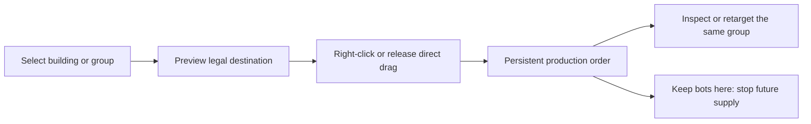

# Historical review ? superseded sandbox snapshots

This file covers the earlier 643/682-line models. They were replaced during the review. See [the final review](REVIEW.md) for the latest 410-line attrition prototype. Fuel, objective, siege, and operation findings here are historical.

# RIM bot assignment usability review

Reviewed 11 October 2026. Object: the current standalone botnet sandbox, [script](../../scripts/botnet_proto.gd) and [design specification](../../design/BOTNET_ATTACK_DESIGN.md). Decision: how to make standing production orders understandable and executable in a few deliberate actions, without automatically assigning the whole map.

## Verdict

**The interface's largest problem is unpredictable selection state, followed by poor order visibility and overbroad source cancellation.** Its shortest single-source attack is already two gestures, but it scales one source at a time and can silently redirect sources the player did not intend to include. Saving one click alone will not resolve this.

The natural object to manipulate is **a building's production assignment**, rather than individual bots or new network connections. The physical network already exists. The player's order means: **“These buildings supply that operation until I change their assignment.”**

Recommend ordinary selection that replaces the current source, deliberate multi-selection, one contextual destination command, an optional direct drag, and a source-level **Keep bots here** command. Separate source inspection from pending order state, and assignment from actual delivery.

## Evidence and scope

- Fully read the 682-line current script and 367-line design document. Three read-only reviewers covered nine skill domains, and findings were reconciled against source and runtime evidence.
- Ran **21 controlled cases through Godot 4.7.2**, using the frozen production script, the actual theme, a 1280×720 SubViewport, mouse events delivered through Godot's GUI input path, real buttons, and controlled simulation steps. Rendered all 21 states using the compatibility renderer. This is engine evidence, not human usability testing.
- The standalone script was copied unchanged. The harness explicitly sized its Control to the scene's intended viewport because it was instantiated inside a SubViewport. It disabled automatic simulation and advanced known intervals for reproducibility. Fixture mutations are recorded separately from ordinary opening states.
- Two starting sources are the normal prototype opening. Ten sources, a disconnected source, and a captured non-war site are deliberate fixtures to expose scale, eligibility, and build interactions; they do not claim an organically played campaign.
- [Source hashes](source_manifest_current.json), [probe](probe_project_current/probe.gd), [runtime results](probe_project_current/results.json), and [render log](probe_project_current/render_stdout.log) are retained. Production scripts, design files, scenes, saves, and economy data were not changed.
- Actual mouse/device ergonomics, novice discovery, preferences between click and drag, controller/touch use, and human error rates remain unknown. The proposed action budgets are design requirements, not measured player performance.

Review domains: interface/accessibility, audience/comprehension, attention, actions/agency, economy/consequences, space/navigation, theme/mental model, narrative consistency, and validation/scope. Dedicated puzzle/hint and multiplayer/community domains were excluded because they do not govern this selection interface. Combat balance, the city renderer, full campaign pacing, and external genre benchmarks were not re-audited.

### Credit for the update during this review

The script changed from 643 to 682 lines during the audit. Earlier evidence remains in `probe_project/`; the repeated current evidence is in `probe_project_current/`. The update added stronger arrowheads, a 6 bots/s aggregate dispatch limit, timed Net Watch sieges, defensive delivery only while the destination is besieged, and right-click cancellation. These are credited: direction is more visible, dispatch becomes gradual, and quiet defense assignments now draw as static routes. Selection and panel defects were rerun on the new source rather than carried forward unchecked. Defense no longer continuously fills a quiet friendly host. Attack streams and active-siege defense streams still use a clock that advances while paused, and attack assignment remains animated without actual dispatch.

## How the current interface works

1. Clicking an owned war-host **toggles it into a cumulative source set**. A normal click does not replace earlier selected sources.
2. Clicking a legal enemy chooses the **one shared pending target**.
3. Dragging an owned war-host to a legal destination **adds that source to the same set and replaces the shared target**. It does not store an independent source→destination link.
4. A panel button commits eligible selected sources: ATTACK for enemies, DEFEND for friendly destinations. The selected source set then clears, but the target often remains.
5. Persistent assignments feed operations after commit. Map routes animate, but the source inspector does not name its current assignment.
6. Clear links clears the draft source selection. It does not stop a persistent order. Retreat ends an entire enemy operation and removes every contributor's assignment.
7. Right-click now cancels routes at the clicked node: its outgoing assignment, every incoming assignment, and an enemy operation at that node. Empty-space right-click only clears the draft.

Evidence: [input](probe_project_current/scripts/botnet_proto.gd#L336), [selection](probe_project_current/scripts/botnet_proto.gd#L374), [attack commit](probe_project_current/scripts/botnet_proto.gd#L434), [defense commit](probe_project_current/scripts/botnet_proto.gd#L398), [clear draft](probe_project_current/scripts/botnet_proto.gd#L450), [retreat](probe_project_current/scripts/botnet_proto.gd#L454).

### Honest action counts

Counts start with a clean selection, an existing bot producer, and Direct already selected. A drag is one sustained gesture, not one click. Optional pause, corrections, objective changes, construction, and discovering controls are excluded.

| Task | Current minimum | Recommended fast flow |
|---|---|---|
| Assign one source to attack | 1 drag + 1 ATTACK click, or 3 clicks | 1 direct drag, or source click + destination right-click |
| Assign two sources to one target | 2 drags + 1 click, or 4 clicks | 1 marquee selection + 1 destination command, when spatially selectable |
| Assign ten sources to one target | 10 drags + 1 click, or 12 clicks | 1 marquee selection + 1 destination command, when spatially selectable |
| Issue ten separate single-source orders | 10 drags + 10 commit clicks = 20 gestures | 10 independent direct drags |
| Retarget a selected group | The current committed source set has cleared, so normally rebuild it | 1 destination command; retain the selected group |
| Retarget one source | Drag + commit, or source + enemy + commit | 1 direct drag, or 2 clicks |
| Support a friendly's defense | Drag + DEFEND; ordinary click targeting does not work | Same order gesture as attacking |
| Stop only one source's future supply | Right-click also cancels incoming routes; no scoped outgoing-only control | Select source + Keep bots here: 2 clicks |
| Inspect a source order | No dedicated order inspector; click changes draft selection | 1 left-click, with no order prepared or committed |
| Change a new operation to Utility | 1 additional click | 1 optional choice; default remains visible and predictable |

Ten scattered, individually chosen sources still require expressing that selection. Marquee is not a claim that an arbitrary subset can always be selected in one gesture. Select contributors and optional group recall can reduce repeated gathering without auto-choosing sources.

## Prioritized findings

### 1. Major: apparent independent links are actually one shared draft

**Observation:** [drag release](probe_project_current/scripts/botnet_proto.gd#L349) adds a source but overwrites `sel_target`. In the engine, dragging RIG A→Host 1, then RIG B→Host 6 yielded sources `{A,B}`, target `6`. ATTACK assigned both to Host 6.

**Mechanism:** two spatial gestures look like two individual orders, but a hidden shared target turns them into a different group order. Consequences become irreversible when dispatch begins.

**Evidence:** runtime cases 04–05; [pending screenshot](probe_project_current/captures/04_two_different_drags.png), [committed screenshot](probe_project_current/captures/05_both_assigned_second_target.png).

**Recommendation:** direct dragging commands exactly the dragged source, or its visibly selected group when it is already a member. Starting a drag from an unselected source must not add unrelated previous sources. In a retained two-step design, call the draft **Selected group → target**, rather than pretending it contains independently drawn links.

**Tradeoff:** direct release commits sooner than the current panel confirmation. A continuous pre-release preview and a precise group indication must make the action deliberate.

**Validation:** order A→X, then B→Y. A must remain assigned to X. Repeat with a deliberate selected group and verify all intended members change together.

### 2. Major: cancellation has a broader scope than stopping one source

**Observation:** the new right-click cancellation is useful when a source has only an outgoing assignment. However, it also clears every incoming assignment. Right-clicking an enemy target additionally erases the entire operation and deployed force. Clear links still only changes draft selection.

**Mechanism:** ?Stop A supplying X? and ?Stop all routes involving A? have different consequences. A local production correction should not also stop B defending A. A routine destination click should not unexpectedly destroy an expensive operation.

**Evidence:** new runtime cases 19?21. With A?X and B?A, right-clicking A cleared both assignments while preserving the already deployed force at X. Right-clicking X erased its active operation and all contributors. See [source cancellation](probe_project_current/captures/19_right_source_cancels_incoming_too.png), [enemy cancellation](probe_project_current/captures/20_right_enemy_erases_operation.png), and [_cancel_at](probe_project_current/scripts/botnet_proto.gd#L363).

**Recommendation:** **Keep bots here / Stop supplying** clears only the selected sources' outgoing assignments. Incoming defense support and deployed operations remain. Separate broader route management from **Retreat operation**. If adopting right-click destination commands, explicitly replace the current broad right-click cancellation binding; do not give the same input both meanings.

**Tradeoff:** a dedicated command adds one control, but narrows a consequential action to match the stated intention. Destructive operation cancellation needs clear loss information and protection from casual inspection/command habits.

**Validation:** stop only A while B continues defending A. A accumulates resident production, the operation at X retains deployed force/progress, and B's incoming support remains assigned.

### 3. Major: inspection and source selection inherit hidden command state

**Observation:** normal clicks accumulate sources, including when the user simply wants to inspect a building. The old target remains after commit and Clear links. No source panel names its current assignment. A captured non-war host sets `sel_build`; later clicking an enemy changes `sel_target` but leaves the Build panel dominant.

**Mechanism:** the latest object clicked does not reliably determine the visible interface or the next action. Players must remember temporary source, build, target, and order state that the interface does not show clearly.

**Evidence:** [selection](probe_project_current/scripts/botnet_proto.gd#L374), [panel precedence](probe_project_current/scripts/botnet_proto.gd#L497), cases 08–09 and 17; [wrong panel screenshot](probe_project_current/captures/17_build_panel_shadows_target.png).

**Recommendation:** ordinary left-click selects/inspects one object, replacing selection. Shift-click deliberately adds/removes members. A selected source shows its standing assignment; selecting it does not inherit a pending target. Selected group and committed orders are separate visible states. After a destination command, retain the selected source group for efficient retargeting.

**Tradeoff:** users accustomed to modifier-free additive selection must learn Shift or marquee. The default becomes safer and consistent with direct inspection.

**Validation:** inspect A, inspect B, inspect an enemy operation, and inspect a construction site. No standing order changes; no unrelated draft silently survives as the next command target.

### 4. Major: attacking and defending use different input grammars

**Observation:** clicking friendly war-host B adds it as a source. Clicking a friendly non-war site switches to Build and clears the source selection. Only a drag chooses a friendly destination. This was reproduced through GUI events in cases 06–07.

**Mechanism:** the learned source→destination interaction works for enemies but fails for allies, exactly when Net Watch may demand a quick response.

**Evidence:** [friendly click](probe_project_current/scripts/botnet_proto.gd#L377), [friendly eligibility](probe_project_current/scripts/botnet_proto.gd#L393), [case 06](probe_project_current/captures/06_friendly_click_adds_source.png), [case 07](probe_project_current/captures/07_friendly_nonwar_opens_build.png).

**Recommendation:** the same explicit destination command resolves to **Attack** for an enemy or **Support defense** for a friendly. Plain left-click remains inspection. Highlight valid destinations as soon as sources are selected; do not require beginning a drag to discover legality.

**Tradeoff:** friendly destination commands must clearly distinguish routed defensive support from keeping bots at home. Use separate names and preview the destination.

**Validation:** perform an attack and a defense-support task through both click and drag alternatives. Equivalent intentions produce equivalent orders.

### 5. Major: current feedback contradicts the running simulation

**Observation:** panel content refreshes on inputs/actions, not continuously. After one controlled combat second, the current HUD displayed 6 active bots while the panel still displayed **active 0**. The operation had 6 active fractional-pool bots under the new gradual-dispatch limit. The earlier snapshot showed the same discrepancy with 9.2 bots rounded to 10; this is not an artifact of that older instant-dispatch model. A production-starved operation with 15 Intel was labelled **waiting for fuel**. Build remained disabled after Intel rose from 15 to 33 until another input refreshed it.

**Mechanism:** false feedback makes successful commands appear unsuccessful and encourages corrective clicks. Repeated inputs caused by stale feedback must not be mistaken for player difficulty with the rules.

**Evidence:** [stale panel screenshot](probe_project_current/captures/03_operation_stale_panel.png), [wrong wait reason](probe_project_current/captures/12_production_wait_named_fuel.png), [stale affordability](probe_project_current/captures/16_stale_build_affordability.png); [process](probe_project_current/scripts/botnet_proto.gd#L181), [waiting flags](probe_project_current/scripts/botnet_proto.gd#L223), [panel](probe_project_current/scripts/botnet_proto.gd#L491).

**Recommendation:** show current values and distinguish **supplying**, **waiting for bots**, **waiting for fuel**, **blocked**, **paused**, and **complete**. Assignment lines represent a standing order; moving packets represent actual delivery. `_t` currently advances during pause, and routes animate based on assignment rather than dispatch: stop presenting those animations as current bot transfer.

**Tradeoff:** more explicit states, but less contradictory information. Do not fill the map with every internal metric; reveal detail in the selected inspector.

**Validation:** change production, fuel, pause, capture, and affordability without clicking. Relevant labels, enabled actions, and flow signals change correctly.

### 6. Major: mixed eligibility and rejected orders are poorly explained

**Observation:** the panel sums bots from every selected source but only some may be eligible. In case 10, the preview said two buildings/20 bots, with one linked; commit assigned only the reachable source and silently cleared both selections. An illegal drag produced no explanation in case 18.

**Mechanism:** the player cannot easily predict which buildings will act or distinguish rejected input from a rule restriction.

**Evidence:** [preview accounting](probe_project_current/scripts/botnet_proto.gd#L521), [commit filtering](probe_project_current/scripts/botnet_proto.gd#L436), [case 10](probe_project_current/captures/10_mixed_eligibility.png), case 18.

**Recommendation:** preview affected versus excluded sources, count only eligible stock, and explain exclusions. Reject a fully invalid command with its reason. For a partial group, a valid order may proceed for eligible sources only when the precommit preview clearly says **7 of 10 will supply; 3 lack a route**. Completion feedback must state what changed, not silently clear excluded members.

**Tradeoff:** partial-group commands save correction steps but must not silently suggest every selected building acted. No additional modal confirmation is needed when the preview is explicit.

**Validation:** select a connected and disconnected source. Before committing, players correctly identify participants and exclusions; afterward they can inspect unchanged orders on excluded sources.

### 7. Minor for the mouse prototype, material for accessible use: no non-drag command parity

**Observation:** map interaction relies on pointer geometry; friendly commands require drag; buttons have `FOCUS_NONE`; Space is the only explicit keyboard command.

**Recommendation:** support a visible **Assign destination** action that opens a clearly identified target-picking state. Clicking either an enemy or friendly then issues the contextual order. This provides a left-button-only alternative without overloading ordinary inspection. Focusable controls and keyboard selection/activation should express the same actions; Escape cancels a preview without cancelling standing orders.

**Tradeoff:** the left-button-only alternative takes one additional interaction but offers the same capability without right-click or sustained dragging. It is an alternative, not another mandatory step in the fast flow.

**Validation:** complete attack, support defense, stop supply, and inspection without using drag or right-click. Player ergonomics and preferred mappings require actual testing.

## Recommended interaction contract

### Selection

- **Left-click source:** select only that source and inspect its current order. Clicking the same source again does not toggle it off.
- **Shift-click:** deliberately add/remove a source from the group.
- **Drag empty map space:** marquee-select owned bot-producing buildings; exclude enemies/non-producers and show the selected count.
- **Left-click another object:** inspect that object; issue no command.
- **Empty-space click:** clear selection; leave every standing order unchanged.
- **Escape:** cancel an active gesture/target-picking preview first; otherwise clear selection. Never treat Escape as Retreat.

### Order

- **Select source(s), right-click a legal destination:** issue the contextual persistent assignment. Enemy → Attack; friendly → Support defense.
- **Optional direct drag:** drag a source to a destination, preview while held, release to commit. If the source is in a visibly selected group, the command applies to that group; otherwise it applies only to the dragged source.
- **No mandatory distant ATTACK/DEFEND button after that explicit command gesture.** This is a proposed usability change, not current implementation.
- Retain the selected group after a successful command so a later destination command can retarget it.
- For a new operation, use a clearly visible default objective. Allow an optional Direct/Utility choice before issuing the order. Reinforcing an existing operation inherits that operation's objective, rather than resetting it.
- Do not introduce a confirmation modal for every routine assignment. Always preview consequences before a command gesture and acknowledge them afterward.

### Non-drag, left-button-only alternative

**Select source(s) → Assign destination → click destination.** An explicit cursor/status says that the next destination click is a command, not ordinary inspection. Enemy and friendly destinations use the same targeting state. Escape cancels safely. This alternative is three clicks for one source and three gestures for a marquee group.

### Existing orders

- Source inspector: **Supplying Host 6 / Supporting RIG B / Keeping bots here / Blocked: no owned route**.
- **Keep bots here:** stop future supply for selected sources; do not recall deployed bots or destroy the target operation.
- Operation inspector: source names, current objective, progress, wait reason, fuel trend, and global warning.
- **Select contributors:** select an operation's current sources in one explicit action. With an already open operation inspector, this plus a new destination command retargets its contributors in two interactions.
- **Retreat operation:** a separate operation action with a clear consequence description. It is never interchangeable with deselection, Keep bots here, or cancelling a preview.

### Preview and feedback

Near the destination, show a concise sentence such as:

> Attack Host 6 · 2 sources · about 9.2 bots initially needed · 18.4 Intel for Direct.

The numerical example is the inspected ordinary-target fixture, not a universal cost. Show affected source names and current orders that will be replaced. Show retained resident bots by source where defensive exposure matters. Mark estimates and do not confuse current resident stock with bots that will actually be dispatched.

During a drag or command preview, distinguish the selected group, destination, legal route, excluded sources, and expected action with text/shape as well as color. On rejection, explain the relevant rule: **Not on your frontier**, **No owned route**, **Not a bot producer**, or **Choose another destination**.

After issuing a command, acknowledge **2 buildings now supplying Host 6**. Inspection and deselection provide selection feedback but never a false order-success message.

## If explicit link-then-commit must be retained

The latest document deliberately describes two steps. Removing its separate commit is a recommendation, not an assumption that the existing requirement has disappeared.

Compare two coherent variants:

| Variant | Single source | Spatially selectable group | Main tradeoff |
|---|---|---|---|
| Recommended explicit destination command | 2 clicks, or 1 direct drag | Marquee + destination command: 2 gestures | Faster; needs clear precommit preview and safe selection semantics |
| Retained preview + local commit | Source→target drag + nearby commit | Marquee + target preview + local commit: 3 gestures | More deliberation; keep the button near the target and avoid per-source link drawing |

Neither variant should require repeating ten drags to express a shared group order. Both need accurate status, source cancellation, inspection, and an equivalent defense flow. Test irreversible first-dispatch errors before deciding which variant to ship. An Undo action must never claim to return consumed bots; at most it can restore future-production assignments.

## Documentation corrections that affect usability

- Accept the current friendly-defense transfer as an intentional newer direction, explicitly disclosed in §11. Do not silently remove it because an older paragraph says self-defense only.
- The document still conflicts with itself about no staging, resident self-only defense, and a supposed home-hold Defend button. Explain **Keep bots here** versus **Support defense elsewhere** consistently.
- State whether received defense bots may later attack from the receiving war-host. The shared resident stock still allows received bots to be reused if they survive the siege and the receiver is a war-host; specify this deliberately rather than inventing a restriction in a selection patch.
- Replace claims that none of the proposed systems are built; they contradict current §11 and the inspected code.
- The actual UI chooses Direct/Utility before commit. Do not continue saying that the player chooses it only after authorizing dispatch.
- The current internal inset is display-only; the precommit objective determines the automatic sequence. Do not present it as a separate interactive node-selection flow.

## Smallest useful validation

Use equivalent click-command and drag-command variants with the same rules and fixtures. Do not change economy, production, or enemy tuning at the same time.

Ask 5–8 participants from the intended audience, without coaching, to:

1. Order A to X and B to Y independently.
2. Send A and B to X together.
3. Retarget only A while B continues X.
4. Keep A's new bots at home without retreating X.
5. Support a threatened friendly building.
6. Inspect all assignments without changing any.
7. Order ten producers together, then retarget that group.
8. Explain production-starved, fuel-starved, blocked, and paused states.

Rotate variant order to reduce familiarity effects. Count clicks, drags, and keys separately; also record corrective actions, unintended participants, wrong destinations, time to a deliberate valid order, and whether participants can predict where each source's next bot goes. Scattered and spatially grouped selection should be separate tasks.

**Proposed acceptance targets:** single-source assignment in one drag or two clicks once learned; spatial group assignment in two gestures; selected-group retarget in one destination command; source stop in two clicks from an unselected source; no additional clicks required to reveal updated status. A destructive Retreat must never be required to stop one source. Independent orders must never redirect unrelated sources.

A small sample identifies confusion, not population preference or an exact error-rate estimate. Prefer the variant with clearer intention and fewer corrections, not merely the lowest nominal gesture count.

## Order of improvements

1. Make selection and independent orders predictable; add narrowly scoped Keep bots here and separate destructive cancellation.
2. Correct live status, wait reasons, affordability, and actual-flow feedback.
3. Introduce one consistent contextual destination command and a non-drag alternative.
4. Add marquee selection and retain groups after orders; add Select contributors for existing operations.
5. Compare direct commitment with the retained local-confirmation variant.

These are player-facing requirements. No gameplay implementation or engine architecture is prescribed by this review. The [Claude handoff](CLAUDE_PROMPT.md) provides a compact implementation request if you choose to pass this on.
