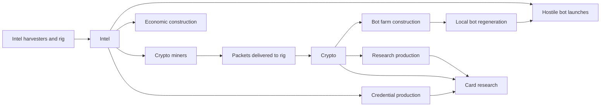

# RIM economy: vision, first implementation, and validation

**Current Claude request:** [CLAUDE_PROMPT.md](CLAUDE_PROMPT.md) defines the finite-assault experiment responding to territorial stalemates. Keep its scope separate from the historical economy and military-cost proposals below.

**Latest follow-up:** candidate A is now present in the working tree. See [MILITARY_ECONOMY_ADDENDUM.md](MILITARY_ECONOMY_ADDENDUM.md) for the reported small-resource-core/full-farm strategy and the next experiments. This original brief and its model preserve the earlier baseline; its source-drift check is expected to fail against changed gameplay until deliberately re-audited.

**Prepared:** 17 October 2026. **Status:** implementation brief with calculated predictions; not playtested balance. **Audience:** Claude implementing the active Botnet prototype.

## 1. Decision

Build an **investment and logistics economy**: Intel funds operations and resource conversion; Crypto funds military expansion and competes with tactical research. Capturing a host should create a decision about how to develop it. Good economic locations and their delivery routes should be worth attacking and protecting.

**Implement candidate A first:**

1. Change a Bot farm from **30 Intel to 30 Crypto**.
2. Change each Intel harvester's storage contribution from **+50 to +15 Intel**; retain the base capacity of 100.
3. Adapt AI purchasing and converter management to that resource change, including zero-Crypto starts.
4. Update prices, help, and construction-shortage feedback.
5. Verify mechanics and run the matched experiments below before calling the economy improved.

The earlier conversational suggestion of **10 Crypto per farm is superseded**. Miners consume one Intel per Crypto, so 10 Crypto would cut the farm's marginal source-resource cost by two thirds after infrastructure is established. It would also make cards much more expensive relative to farms. **30 Crypto preserves the existing 30-Intel input cost**, while adding mining throughput, infrastructure, delivery, and competing uses of Crypto. Test 20 only if the specified opening/recovery guardrails fail at 30.

This is a first implementation candidate, not a claim that two parameter changes solve every snowball. Existing farms still regenerate freely and Crypto remains uncapped. The experiment must distinguish a new investment decision from moving the old stockpile into another currency.

This handoff defines the intended implementation scope for Claude. The preparation of this bundle has not changed gameplay files.

## 2. Economy vision

### Player decisions

- **Before expansion:** prepare Intel for departures and Crypto for developing the captures, or spend that Crypto on a card that creates an opening.
- **After a capture:** choose an attack source, a defensive stronghold, an economic site, or an undeveloped transit/guard host. Filling every slot with farms should have a visible opportunity cost.
- **During a sustained campaign:** add production or secure richer miners when the desired construction rate exceeds delivered income. Pausing development to fund a card is a legitimate choice.
- **Under pressure:** protect miners and routes, interrupt the opponent's future investment, and use existing forces while rebuilding income.

Winning territory should still be rewarding. A mature, well-defended economy may run a surplus. The target is repeated meaningful choices during the contested part of a match, not permanent poverty or a tax that punishes every capture.

| Resource | Intended role | Concrete decision |
|---|---|---|
| Intel | Operational budget; also the source input for Crypto and Credentials | Attack now, construct economic infrastructure, or fund conversion |
| Crypto | Investment budget and tactical opportunity cost | Build farms, produce Research, or fund card research |
| Credentials | Specialized tactical preparation | Invest slots and Intel in access to useful cards |
| Research | Specialized tactical preparation | Convert Crypto into card capability instead of immediate farms |
| Bots | Local force, defense, and expendable attack packets | Keep defenders, reinforce, or attack |
| Slots, host type, location, and routes | Economic geography | Use a rich host for output or military presence; protect its delivery path |

Credentials and Research need not be mandatory in every winning strategy. Their success criterion is a credible tactical alternative with useful counterplay. Do not add them to ordinary building prices simply to force every resource into every match.



The mixed relationships matter: more production has a measurable cost; the value of a location or card depends on the map and opponent. Do not rank every option on one universal power scale.

## 3. Verified current rules

Use **`scripts/botnet_cfg/*.gd` and `scripts/botnet_proto.gd`** as authority. `project.godot` starts `scenes/botnet_proto.tscn`. **Do not implement this through `data/economy.json` or the legacy `scripts/econ.gd`.** Older design documents contain stale combat and card rules.

The working tree already had edits to `scripts/botnet_proto.gd` and `project.godot` during preparation. Preserve those changes. Source fingerprints and parameters used for the numerical model are recorded in its results; re-read the live files before editing. Function names below are more reliable than old line numbers.

### Starting position

Each normal faction starts with:

- 50 Intel; zero Crypto, Credentials, and Research.
- A value-1 Server rig: three slots, two Bot farms, 60 bots.
- An adjacent value-1 PC: three slots, one Bot farm, 30 bots.
- Three empty slots across these two hosts, no miners or harvesters.
- Native rig income of 1 Intel/s while the rig works and remains owned.

There are **three farms but only two starting hosts/attack sources**. Keep these starting installations and forces. A normal start must not need Crypto to preserve or operate its existing army.

### Production, costs, and caps

| Item | Current rule |
|---|---|
| Harvester | Costs 10 Intel; produces 1 Intel/s times host multiplier; adds 50 Intel capacity |
| Bot farm | Costs 30 Intel; produces 1 bot/s times host multiplier without resource input |
| Crypto miner | Costs 50 Intel; output per installation is `host.value * type.cash / 3` Crypto/s; each Crypto consumes 1 Intel |
| Credential harvester | Costs 50 Intel; produces `0.5 * type.cred` Credentials/s, consuming 1 Intel each |
| Research lab | Costs 50 Intel + 25 Crypto; produces `0.5 * type.research` Research/s, consuming 1 Crypto each |
| Intel capacity | `100 + 50 * owned built harvesters` |
| Credentials / Research capacity | 50 base plus 50 per corresponding built producer |
| Crypto capacity | No cap |
| Hostile departures | Each attack or scan bot costs 1 Intel; friendly reinforcement costs none |
| Construction | 10 seconds of fully funded work; replacement first requires 5 seconds of demolition |
| Card research | Pays Crypto, Credentials, and Research over funded research time; no full-cost requirement to enter the research queue |

Host bonuses affect output, not the harvester's storage contribution. Intel harvesters on DB/File hosts produce twice the base output. Their current cost repayment is 10/5 seconds **after completion**, or 20/15 seconds from the start of uninterrupted construction. A farm's 30-Intel price being three seconds of income at +10/s does not remove its ten-second construction time.

Owned hosts normally hold `30 * max(1, built farms)` bots. Multiple farms increase regeneration and storage; **each host's normal outgoing stream remains capped at 1 bot/s**. Four farms on one ordinary host regenerate four defenders per second; this is also a defensive stacking issue.

Captures clear installations and construction. Empty captures can receive guards, route packets, and hold up to 30 bots. They do not require a local farm to function as transit or reinforced territory.

### Funding and delivery semantics

- A construction order requires the full displayed price in the bank when accepted. It is **not reserved**. The job snapshots its cost and pays over funded work.
- Several jobs may be accepted against the same bank. They share scarce funding and finish more slowly; this is not free construction.
- Paused jobs spend nothing. Cancellation returns nothing. Do not change these semantics incidentally.
- Relevant step order: bot regeneration; Intel income/cap clamp; card research spending; due departures; construction funding; production conversion; arrivals; AI decisions.
- Therefore card research spends Crypto before farm jobs, and farm jobs spend Crypto before labs convert it to Research. Preserve this priority for candidate A and make stalls understandable.
- Normal mined Crypto is usable after delivery to the rig. Packet sizes, route length, congestion, interruption, and input starvation can reduce/delay the average rate.
- Construction spends a global bank. Do not invent a new requirement that every farm have its own miner or supply route to the rig.
- Losing a harvester lowers capacity and the next Intel tick clamps surplus away. Built inactive harvesters still add capacity; incomplete harvesters do not. Preserve this behavior.

## 4. Exact candidate A contract

| Setting | Baseline | Candidate A |
|---|---|---|
| Bot farm price | `{"intel": 30.0}` | **`{"cash": 30.0}`** |
| `INTEL_CAP_PER_BUILD` | 50 | **15** |
| `INTEL_CAP_BASE` | 100 | 100 |
| Harvester price and output | 10 Intel; base 1/s | Same |
| Miner price and conversion | 50 Intel; 1 Intel per Crypto | Same |
| Build / demolition time | 10 / 5 funded seconds | Same |
| Starting resources and forces | As above | Same |
| Per-bot production cost | None | None |
| Per-host upkeep | None | None |
| Capture settling lock | None | None |
| Card prices/effects, bot regeneration/storage, attack rates | Current configuration | Same |

`cash` is the existing internal key for the player-facing resource **Crypto**. Do not introduce a second wallet or rename network fields.

The changes intentionally leave economy producers vulnerable through existing capture, DDOS, Phishing, and routing rules. Disrupting miners delays **future construction and cards**; it does not switch off already-built Bot farms.

## 5. Calculated predictions

These are resource-budget and scheduling predictions, not measured match outcomes. Run the accompanying model and consult its assumptions. Continuous-rate estimates do not replace packet-level opening tests.

### Intel reserves

| Built harvesters | Baseline capacity | Candidate capacity |
|---:|---:|---:|
| 0 | 100 | 100 |
| 4 | 300 | 160 |
| 8 | 500 | 220 |
| 10 | 600 | 250 |
| 20 | 1,100 | 400 |

At a hypothetical net +5 Intel/s and no new spending, going from empty to the ten-harvester cap takes 120 seconds currently versus 50 seconds in the candidate. This is **not** a prediction of army exhaustion: actual net flow changes with attacks, construction, and conversion. The smaller cap limits prepared bursts and may increase wasted overflow; it does not reduce sustained output.

### Mining throughput and farm affordability

| One fully funded miner | Crypto/s | Time to generate 30 Crypto, continuous-rate estimate |
|---|---:|---:|
| Value-1 ordinary host | 0.333 | 90 s |
| Value-2 ordinary host | 0.667 | 45 s |
| Value-3 ordinary host | 1 | 30 s |
| Value-3 ERP | 1.5 | 20 s |

These exclude miner construction, competing spending, and transport. For the ERP example, 4.5-Crypto packets every three seconds cross 30 at the seventh funded packet: about 21 seconds before additional travel/step effects, not precisely 20 seconds.

Three ordinary outer-city miners provide 1 Crypto/s. They can sustainably fund two 30-Crypto farms per minute **if nothing else spends Crypto**. Keeping an ordinary lab continuously supplied consumes 0.5 Crypto/s and leaves enough for one farm per minute. Runtime priority can instead allow construction to starve that lab; the latter calculation is a desired budget allocation, not an enforced lab reserve.

Filling one three-slot host entirely with farms costs 90 Crypto. Doing that every 30 seconds requires 3 Crypto/s before card/lab spending: nine ordinary outer miners, three ordinary downtown miners, or two downtown ERP miners. These are required **delivered rates**, not mandatory miner counts on every map. A single first farm per capture needs only one third of that budget.

### Why the farm price is 30, not 10

| Farm price | Source Intel per farm after mining is established | One outer miner's saving time | Farms foregone by Supply's 80-Crypto total pipeline cost |
|---:|---:|---:|---:|
| 10 Crypto | 10 | 30 s | 8 |
| 20 Crypto | 20 | 60 s | 4 |
| **30 Crypto** | **30** | **90 s** | **2.67** |

With one 50-Intel miner, N farms require `50 + price*N` source Intel, excluding all other costs. At 10 Crypto, three farms cost 80 source Intel including that miner, versus 90 Intel directly today. At 30 Crypto, the source cost is `50 + 30*N`: the additional burden is the infrastructure and pipeline, not a hidden currency discount.

Supply requires 40 direct Crypto + 40 Research + 30 Credentials. Producing that Research from zero requires another 40 Crypto, so the combined pipeline is 80 Crypto, before lab setup and Credentials. DDOS similarly requires 150 Crypto through both stages. These are resource comparisons, not claims that cards are always better than the corresponding number of farms.

### Opening and recovery scenarios

**Named one-miner opening:** begin with 50 Intel and no Crypto, order a miner, fund it without interruption, use one ordinary miner only, spend nothing else from its Crypto, then order a farm. At a 30-Crypto farm price: 10 seconds miner construction + 90 seconds saving + 10 seconds farm construction = **about 110 seconds**, before delivery/step effects. The corresponding 20/10-Crypto scenarios are 80/50 seconds.

**Named recovery:** zero Intel/Crypto, a working owned rig, an empty slot, no other spending, and the same direct one-miner plan adds 50 seconds to save the miner's Intel cost: **about 160 seconds** at 30 Crypto before travel/step effects.

These are specific build orders, **not global minimum times**. Extra harvesters or miners can change them; attacks, queued research, or broken routes can lengthen them. Existing starting farms continue operating. If every farm is lost, the rig's Intel only enables rebuilding infrastructure; it does not itself regenerate bots without a farm.

### Expected behavior and uncertainty

| Prediction | Evidence level | What would contradict it |
|---|---|---|
| An Intel-only bank cannot immediately fund new farms | Direct consequence of the new price | Any code path spending Intel for candidate farms |
| Smaller Intel reserve constrains saved bursts | Exact cap calculation | A bypass allowing banked Intel above cap |
| Productive miners and their delivery paths become more valuable | Supported design hypothesis | Adapted play never needs to protect or expand mining |
| Players sometimes leave captures partially developed | Hypothesis | Every capture is still immediately filled with farms from a standing wallet |
| Cards compete with additional military infrastructure | Shared-wallet fact; strategic viability unknown | Card investment is consistently unaffordable or strictly inferior in relevant tactical fixtures |
| Expansion remains economically interesting throughout a contested match | Unproven target | A small fixed miner core plus stockpile restores the same uninterrupted farm-spam strategy |

## 6. Implementation work for Claude

### Configuration and compatibility

- Edit `scripts/botnet_cfg/buildings.gd` and `scripts/botnet_cfg/tuning.gd` for the two numerical changes.
- Reuse generic resource-price dictionaries and job snapshots in `_build_cost`, `_can_afford_build`, `_start_job`, and `_tick_jobs`.
- Restart the scene after changing constants. Preserve existing user changes and unrelated features.
- For a distributed gameplay build, bump both `GAME_VERSION` and `project.godot`'s app version using the repository's version convention. Lobby version separation must keep clients with different simulation rules apart. Documentation-only preparation does not require a version bump.

### AI: required correctness work, not optional polish

Normal AI currently chooses a frontier farm before its miner fallback. If the farm becomes unaffordable because Crypto is zero, its Intel-only saving logic may keep choosing that farm forever.

Required behavior:

1. At zero Crypto, recognize the need for a working, connected miner before additional farms can be built.
2. If a desired farm is unaffordable, choose an affordable useful economic alternative or deliberately save the resource needed for it. An unaffordable preferred farm must not block miner construction.
3. Count miner jobs already in progress, current delivered output, outstanding construction obligations, and planned card research when evaluating needs. Do not repeatedly create duplicate bootstrap jobs.
4. Budget Crypto alongside Intel. Pause appropriate conversion/research when deliberately saving for critical construction, using the same existing player-accessible controls and fair-view information.
5. Retain deterministic decisions and avoid assigning income to disconnected or disabled miners.

Relevant Normal entry point: `_ai_think` build/saving block in `botnet_proto.gd`.

The experimental Insane brain's `_economy` and `_converters` also assume farms use Intel and introduce miners through a card-core gate at four hosts. Make its resource assumptions compatible and test the zero-stock case. **Do not enable Insane in the UI:** `INSANE_READY` is currently false. Treat Insane results as harness stress tests, not a supported live difficulty claim.

### UI and tutorial

- Display **30 Crypto** on every Bot farm purchase surface and **+15 Intel capacity** for harvesters.
- Update `BUILD_KINDS` descriptions, `BUILD_EFFECT`, and the construction help illustration in `scripts/botnet_help.gd`; its current wording assumes all construction costs 10–50 Intel.
- Reuse generic cost rendering. Update comments or help that describe Crypto as only for cards.
- Add construction-specific funding feedback to `SlotBox`: a farm job lacking Crypto must visibly say **Needs Crypto** and show paused/partial progress accurately. The existing producer footer does not cover construction jobs.
- Preserve observed resource-rate accounting. Do not label gross miner output as spendable net Crypto.
- Existing pause controls for research/labs must remain discoverable, so saving for farms is an intentional action.
- Keep tutorial gifts distinct from normal-start evidence. The tutorial supplies extra producers and card resources; it cannot validate opening affordability.

### Mechanical verification

Extend relevant existing suites rather than creating a second game simulator:

| Case | Required result |
|---|---|
| Intel-rich, zero-Crypto faction orders farm | Rejected without resource loss |
| 30 Crypto, adequate free slot | Accepted; pays 30 over ten fully funded seconds |
| Several accepted farm jobs sharing 30 Crypto | Total spending is conserved; no negative bank or free completed farms |
| Research and farm job compete | Existing priority is preserved; both show truthful funding state |
| Pause/cancel/replace | No spending while paused; no cancellation refund; five-second demolition before replacement construction |
| Eight/ten harvesters | Intel caps 220/250; loss clamps surplus; incomplete jobs add no cap |
| Miner route cut, DDOS, Phishing, capture | Existing input/payment/delivery semantics remain correct; no free Crypto or phantom usable income |
| Normal zero-Crypto frontier-farm preference | Builds/bootstrap-funds a miner instead of repeating an impossible farm request |
| Experimental Insane zero-stock opening | No circular farm/miner prerequisite; committed Crypto handled consistently |
| Multiplayer construction | Identical banks, jobs, and state hashes under candidate farm commands |

Relevant tests include `production_cost_test.gd`, `botnet_usability_test.gd`, `botnet_ui_edge_test.gd`, `botnet_help_test.gd`, `four_card_effect_test.gd`, `mp_lockstep_test.gd`, and `ai_insane_test.gd`. Run server end-to-end coverage when producing a multiplayer build. Use commands from `BUILD.md` with the available Godot executable.

`ai_card_smoke_test.gd` seeds 200 Crypto and cards. Passing it is not evidence that an unfunded normal-start AI can establish this economy. Add an actual zero-Crypto bootstrap regression.

## 7. Validation: measure decisions, not just longer matches

All targets below are **provisional design acceptance criteria**, not observed results. The numerical model only verifies its defined budget model. Full game mechanics and player behavior still need testing.

### Controlled comparison

Use seeds **7, 19, and 43**, one fixed small map size, two opponents, the same faction/spawn and initial state per pair. Record actual generated host count and layout. Keep the common resource-aware AI logic in both baseline and candidate builds, with only the two economy parameters changing, so an AI bug or unrelated AI improvement cannot explain the result.

Run both policies:

1. **Original opening:** Intel accumulation, then filling new captures with farms.
2. **Adapted opening:** optimize mining locations and build enough miners to support the same plan, avoiding cards. This adversarial policy tests whether the dominant behavior merely acquired a miner prerequisite.

Three seeds × two policies × two rulesets = **12 primary runs against Normal**. Use the same reproducible decision policy, or the same experienced player with an explicit decision log; identical clicks are not comparable when affordability changes. Stop recording at match end or 15 minutes. Optionally repeat the matrix against the experimental Insane harness for another 12 stress runs; do not enable the unfinished difficulty.

Record at least:

- Time of first capture, first working miner, first additional farm, first card ready/played, and match end.
- Intel/Crypto balance, income, spending by purpose, and overflow at five-second intervals.
- Crypto produced versus delivered; seconds routes or inputs blocked production.
- For each capture: time until first farm; time until all available slots are farms; alternative economic uses chosen.
- Which jobs stalled and why; how often the AI chose an unaffordable build without an economic recovery action.
- Capture/loss sequence, attack sources, farm counts, and economic composition at the early, middle, and late contested stages.

### Decisive fixtures

1. **Bootstrap:** normal start, no grants. First additional farm median at or below 120 seconds, none above 180 seconds across the three economy-aware runs, unless combat explains the delay. No repeated unaffordable-farm AI loop.
2. **Prepared expansion:** save a comparable midgame state; run equal starting banks as the controlled case, and each ruleset's full Intel cap as a separate reserve test. Economic constraints should create a documented choice about development/card spending. Longer timers alone do not pass.
3. **Mining interruption:** stop delivered mining income for 60 seconds with Crypto banks 0, 30, and 100. Count farm jobs completed, stalled jobs, card delay, and recovery. Also test a deliberately large Crypto wallet. Report honestly when savings absorb the entire disruption.
4. **Card alternative:** on a farm-heavy defended host, compare investing in a relevant Supply/DDOS play with buying more farms. Begin with comparable normal earned resources; count all conversion/setup costs and travel. A card path must have at least one useful tactical outcome without developer-granted resources. This is not a claim that every card must be bought every match.
5. **Recovery:** keep the rig and a buildable slot, remove miners, empty both banks, pause spending, and establish income again. Verify no rules deadlock. The direct one-miner 160-second calculation is a reference scenario; test an optimized recovery build too.

### Decision rules

Accept candidate A as an **improvement to investment choices** only when mechanical/AI tests pass and repeated play contains observable decisions between military development, economic expansion, and tactical spending. A surviving alternative strategy must exist; do not count an AI that fails to buy miners as evidence of balance.

Revise if median match duration rises more than 25% over the paired baseline without new decisions, the opening guardrail fails due to economic waiting, or saving for a useful card becomes impractical even with appropriate investment and pause controls.

If 30 fails these pacing guards, compare **20 Crypto** on the same fixtures. Use 20 only if the opening improves while the investment decisions remain. Restore 30 if 20 merely recreates immediate mass development. Do not silently choose 10: its lower material cost and card opportunity cost require a separate justification.

If the adapted no-card policy restores the original uninterrupted expansion through a small fixed miner core and growing Crypto bank, mark **the sustained snowball target unproven/failed**. Do not claim success because the first few captures took longer.

With only a few runs, report per-seed outcomes and paired differences; do not claim a population win rate or statistical proof of balance.

## 8. Follow-up decisions, gated by evidence

These are not part of candidate A. Do not combine all of them into the first patch.

| Observed failure | Next isolated experiment | Reason / guardrail |
|---|---|---|
| Harvester rush still makes every Intel decision trivial | Harvester price `min(50, 20 + 5*n)` Intel | `n` counts currently owned installed harvesters and pending new harvesters; snapshot each quote. Avoid exponential price/cap lockouts. Count an installed harvester being replaced once, not twice. Rebuilding after losses must not retain a permanent historical price penalty. |
| The same army expansion resumes behind a large Crypto wallet, regardless of miner pressure | Revisit a cost on **actual bot regeneration**, starting with the earlier 0.25-Crypto candidate in a separate model/patch | Requires explicit spend control, recovery allowance, AI budgeting, and card-viability tests; existing bots must not disappear. Do not add it automatically on top of this construction-price change. |
| Captures become secure before a reasonable counterattack can arrive | Test **10 seconds settling**, then existing ten-second construction | Visible timer; reinforcements/routing continue. Measure the result independently of farm prices. |
| Stacked farms prevent retaking hosts despite competitive economies | Test total ordinary-host regeneration of **1 / 1.5 / 1.75 / 2 / 2.25** for 1–5 farms | Preserve storage in the first test, retain host multipliers; distinguish defensive stacking from economic affordability. |

Reject the suggested unbounded ×1.5 price curve: with eight harvesters and +15 storage each, capacity is 220 while the ninth costs about 244–256 depending on rounding. Full-price queue checks make it impossible to buy. Even the old +50 capacity eventually loses to exponential prices.

Defer 0.2 Intel/s per owned host upkeep. Twenty hosts would cost 4 Intel/s while the rig supplies only 1/s. Without a shortage/recovery design, losing production could prevent the savings needed to replace it. This also conflicts with a capture settling lock that charges ownership while forbidding local development.

## 9. Deliverables expected from Claude

1. Candidate A implementation and a concise file-by-file explanation.
2. Mechanics, AI bootstrap, UI/help, and multiplayer verification results; identify anything not run.
3. Reproducible baseline/candidate playtest logs or harness results, including the adapted miner-heavy strategy.
4. A verdict: improved investment choices, pacing regression, relocated stockpile, or insufficient play evidence. Separate exact mechanics from predictions and player observations.
5. Any proposed next change tied to a failed criterion above, with revised numbers and a focused test. Do not quietly ship the optional experiments together.

The accompanying Python tool, editable parameters, README, and result file allow Claude to reproduce the budget calculations. They are an executable specification of the **limited prediction model**, not a replacement for the Godot simulation or playtests.

## 10. Evidence included with this handoff

Run from the repository root:

```powershell
python tools/balance/economy_handoff/model.py
```

The supplied run of model **1.1.0** passed **16 known-case checks**, plus nonnegative-stock and money-conservation assertions across its construction scenarios. It retains baseline, 30-Crypto candidate, 20-Crypto fallback, and superseded 10-Crypto results. Price, capacity, miner location, construction cadence, lab budget, opening/recovery, and outage comparisons are in `results.json`; assumptions and editable inputs are in `README.md` and `parameters.json`.

One important boundary is preserved: queuing three 30-Crypto jobs against a 30-Crypto bank admits all three, but with no income none finishes under proportional funding. Queuing only one would finish it. With 90 Crypto, all three can finish after ten funded seconds. This explains why both player decisions and funding behavior belong in the runtime tests.

**Not performed:** Godot implementation, full-match simulations, human playtests, or a win-rate estimate. The predictions establish resource relationships and named budget scenarios, not a verified solution to the reported dominant strategy.
